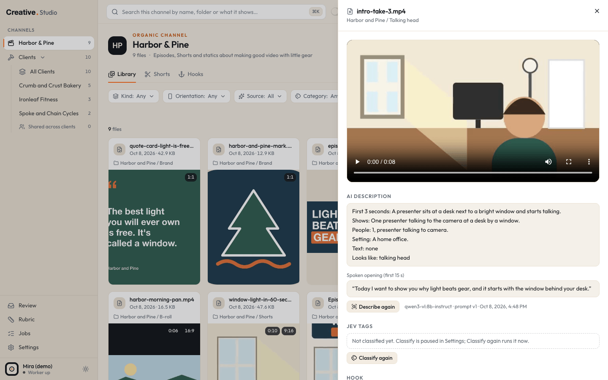
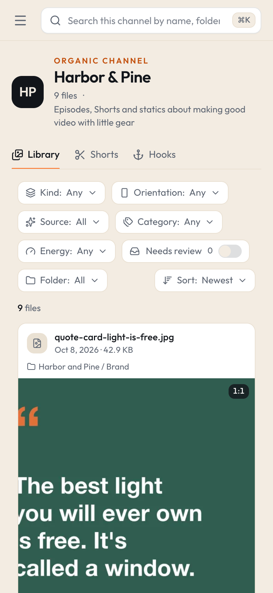

# Creative Studio

Creative Studio is a local app for people who make a lot of marketing media: your own brand's videos and Shorts, ads for
clients, and ads for one company of your own. It indexes the folders where your media already lives (without moving or
changing a file), makes thumbnails and small previews, and gives you one place to browse, describe, tag and search it.
On top of that it scores ad hooks, shows how your Meta ads are doing next to the files they use, plans Shorts from your
episode transcripts and makes new images and videos through tools you already pay for. It runs on your Mac only, on
`127.0.0.1`, and every outside service is optional.



## What you can do

Studio has three lanes of channels: **the Brand lane** for your own content, **the Clients lane** with one channel per
client, and **the Company lane** for one standalone company. You can rename them and switch the Brand lane or the
Company lane off.

- **Library:** every image and video in your folders, with thumbnails, hover previews, filters (type, shape, folder,
  client, category, energy), a detail drawer and search by file name, path or description. Turn on **Meaning** to search
  by what you mean instead of exact words.
- **Generate:** make images and videos with Higgsfield or ChatGPT images (through the Codex CLI), plus quick tools on any
  card (upscale, remove background, reframe to 9:16). Every Higgsfield run shows its quote first and needs one click to
  confirm.
- **Describe, Classify and Review:** a local vision model writes what each file shows and says; Jev (TypeSafe) files
  each one (category, client, energy, hook potential and more); answers it is unsure about wait in a keyboard driven
  Review queue.
- **Hooks, Rubric and Client tab:** collect text hooks and video hooks per channel, score them against a rubric you can
  edit, see which hook styles you have not tried yet, ask for rewritten variants, and keep brand notes per client.
- **Running:** your Meta ads per channel (spend, leads, cost per lead, CTR, hook rate and more) linked to the local files
  they use, with flags for tired ads and winners, a calibration report that checks scores against results, and a
  **New PAUSED ad** dialog that stages an order file for a separate apply script to pick up (not included, see
  [below](#outside-tools)).
- **Shorts board:** turns an episode's transcript into short clip ideas with a strong cold open, moves each card from
  Idea to Posted, hands approved clips to a reel cutting tool as a list (the tool is not included, see
  [below](#outside-tools)), and shows your YouTube Shorts with their numbers.
- **Jobs:** every queue and error in one place, with Retry and Clear.
- **Settings:** lanes, clients, media folders, folder rules, ignore patterns, engines, AI, Claude, Meta, YouTube and
  paths.

The layout also fits a narrow window. Under 768 px the channel list moves into a menu and the filters wrap above the
cards:



## Requirements

- A Mac with Apple Silicon (M1 or newer) and at least 16 GB of memory. Intel Macs, Linux and Windows are not supported.
- macOS. Tested on macOS 27.2.
- [Homebrew](https://brew.sh), Node.js 22 or newer, ffmpeg and git. The [install guide](docs/install.md) covers each one.
- Optional: Ollama, whisper.cpp and the keys or logins for the services you want (see the table below).
- Optional: Google Chrome, needed to build the desktop app (`launcher/build_app.sh` renders its icon with it). When Chrome is
  installed the desktop app also opens Studio in a Chrome app window; otherwise it uses your default browser.

## Try the demo first

The demo is a full Studio filled with a made-up brand and three made-up clients. It needs no keys, no media drive, no
Ollama and no paid service, and it stays apart from any real install on the same Mac. You do need Node.js 22 and ffmpeg
first (steps 1 to 3 of the [install guide](docs/install.md)), and git (macOS offers to install it the first time you
use it).

```bash
git clone https://github.com/ronnytiburcio/creative-studio.git
```

```bash
cd creative-studio
```

```bash
npm install
```

```bash
npm run demo
```

If this fails, see [Troubleshooting](docs/troubleshooting.md). Warnings that say "Dynamic filesystem access causes tracing of the whole project" are expected and harmless.

The first run builds the app, which takes a minute or two. When you see this line, open
[http://127.0.0.1:4750](http://127.0.0.1:4750) in your browser:

```text
demo: Creative Studio (demo) is running on http://127.0.0.1:4750  (Ctrl+C stops it; every number and name is made up)
```

Press Ctrl+C in Terminal to stop it. To start over with a fresh demo, run it with `--reset`:

```bash
npm run demo -- --reset
```

## Install it for real

Follow the [install guide](docs/install.md). In short: install the tools, clone the repo, run `npm install`, point
Studio at your media folder, start the web app and the worker, and add the services you want one at a time.

## What works without which key

Everything in the first row works with nothing extra installed. Each other feature needs the services marked **yes**;
**opt** means it works without that service but does more with it.

| Feature | Nothing | Ollama | whisper | Jev key | Meta token | GHL key | YouTube | Higgsfield | Codex | claude CLI | Costs money |
|---|---|---|---|---|---|---|---|---|---|---|---|
| Library: index, thumbnails, previews, filters, search by name and path | yes | | | | | | | | | | no |
| Describe: what each file shows, search over descriptions | | yes | opt | | | | | | | | no (local) |
| Classify, Review queue, Library category and energy filters | | yes | opt | yes | | | | | | | yes, Jev per call |
| Search by meaning (the Meaning switch) | | yes | | yes | | | | | | | yes, Jev per search |
| Hooks: add, paste, import, archive; Rubric editing; Client tab notes | yes | | | | | | | | | | no |
| Hook scores, coverage by hook style, Rescore | | | | yes | | | | | | | yes, Jev per hook |
| Video hooks (one per strong video) | | yes | opt | yes | | | | | | | yes, Jev per hook |
| Rewrite variants of a hook (Jev scores them) | | | | opt | | | | | | yes | your Claude plan (+ Jev) |
| Generate images and videos, quick tools | | | | | | | | yes | | | yes, Higgsfield credits |
| Generate with ChatGPT images | | | | | | | | | yes | | your ChatGPT plan |
| Running tab: ad numbers, flags | | | | | yes | | | | | | no (read only) |
| Leads from GHL with per ad credit | | | | | yes | yes | | | | | no (read only) |
| Calibration: scores against Meta ad results or YouTube Shorts results | | | | yes | opt | opt | opt | | | | Jev for the scores |
| New PAUSED ad: stage an order file | yes | | | | opt | | | | | | no |
| New PAUSED ad: "Draft the rest" of the copy | | | | | | | | | | yes | your Claude plan |
| Shorts board: clip ideas from an episode transcript | | yes | yes | yes | | | | | | yes | your Claude plan + Jev |
| Shorts board: Posted column, YouTube Shorts list and numbers | | | | | | | yes | | | | no (read only) |
| Copy gate and page scorer command line tools | | | | yes | | | | | | | yes, Jev per line or section |
| Jobs page, Settings | yes | | | | | | | | | | no |

Notes:

- **Jev (TypeSafe)** is the only scoring engine. Without a Jev key nothing is classified or scored; every row above
  that does not need it still works. Each call costs a small fraction of a cent, and a daily cap (default $1, up to $20, set in Settings) stops
  calls for the rest of the day. TypeSafe publishes the price as $42 per billion input tokens. Keys are made in
  TypeSafe's [API console](https://console.typesafe.ai/) under API Keys. When this was written (October 2026), TypeSafe
  had paused new sign ups, so check the console first; Studio works without a key, just without scores. See
  [Jev](docs/integrations/typesafe-jev.md).
- **Ollama** and **whisper.cpp** are free and run on your Mac. Nothing you describe leaves it.
- **Meta, GHL and YouTube** are read only: Studio never changes an ad, a contact or a video. Creating a paused ad from a
  staged order is the job of a separate apply script you run yourself (see [Outside tools](#outside-tools)).
- **Higgsfield** and **Codex** cost what those services charge you. Studio quotes Higgsfield runs before you confirm.
- **claude CLI** runs with your own Claude subscription login, never an API key.
- Calibration needs either Meta (for ads) or YouTube (for the Brand lane's Shorts).
- Clip ideas need the episode video filed as an episode (Classify does that) and its transcript as a `.srt` file in the
  same folder, named with the episode prefix (`Episode 3.srt` by default; see the [Shorts guide](docs/guide/shorts.md)).
  One way to make it: turn the audio into a WAV with ffmpeg
  (`ffmpeg -i "Episode 3.mov" -ar 16000 -ac 1 "Episode 3.wav"`), then run
  `whisper-cli -m <model file> -f "Episode 3.wav" -osrt -of "Episode 3"`, which writes `Episode 3.srt`.

## Outside tools

A few features hand work to tools that are **not included in this repo**: an ad apply script (creates the paused ad in
Meta from a staged order), a reel cutting tool, an explainer tool and an episode prep tool. Studio does not run them. It
writes documented files for them, [Cut reel hand-off lists](docs/formats/cut-reel-handoff.md) and
[ad orders](docs/formats/ad-orders.md), and reads back [kit notes](docs/formats/kit-notes.md). Without these tools
everything else in Studio still works; the staged files simply wait until something picks them up.

## Documentation

The full manual, with a link to every page (the guide, the integrations and the file formats), is in
[docs/README.md](docs/README.md). Good places to start: [Install](docs/install.md),
[Configuration](docs/configuration.md) and [Troubleshooting](docs/troubleshooting.md). Also see
[Security](SECURITY.md) and [Contributing](CONTRIBUTING.md).

## License

MIT. See [LICENSE](LICENSE).
