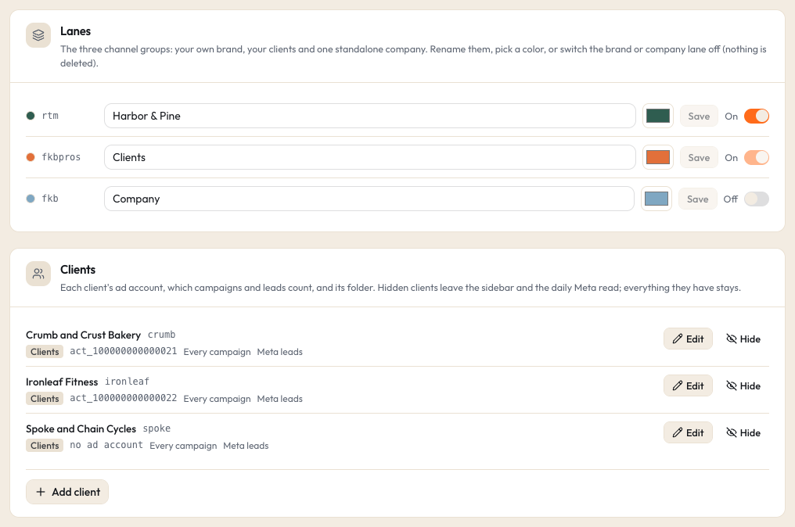

# Configuration

Studio reads its settings from four places. This page explains each one, lists every setting with its default, and
describes the config file and the business profile. If you have not installed Studio yet, start with
[Install](install.md).

- [Where settings come from](#where-settings-come-from)
- [The settings folder and the data folder](#the-settings-folder-and-the-data-folder)
- [Every setting](#every-setting)
- [Switches you rarely need](#switches-you-rarely-need)
- [Lanes and their keys](#lanes-and-their-keys)
- [The config file: studio.config.json](#the-config-file-studioconfigjson)
- [The business profile](#the-business-profile)
- [Folder tag rules and ignore patterns](#folder-tag-rules-and-ignore-patterns)

## Where settings come from

Studio reads every setting in this order and uses the first value it finds:

1. **The process environment:** a variable set in Terminal for one run, like `STUDIO_PORT=4800 npm run dev`.
2. **Your settings file:** `~/.studio/.env`. When it is missing, Studio creates it from a template on start; it never
   changes the file after that. `.env.example` in the Studio folder is a copy of that template.
3. **The `env` section of your config file** (`studio.config.json`, see [below](#env)).
4. **The built in default** shown in the [table](#every-setting).

Settings are read when the web app and the worker start. After you change one, restart both (with the LaunchAgents:
`launchctl kickstart -k gui/$(id -u)/com.studio.web` and the same for `com.studio.worker`). The Jev key is the one
exception: Studio reads it again for every request, so a pasted key works at once.

### A worked example

Say you want to know which media location Studio uses (`STUDIO_DRIVE`):

| Layer | What it says | Result |
|---|---|---|
| Built in default | `~/Studio-Media` | used when nothing else is set |
| Config file `env` | `"STUDIO_DRIVE": "/Volumes/Media Drive"` | wins over the default |
| `~/.studio/.env` | `STUDIO_DRIVE=~/Movies/Studio Media` | wins over the config file |
| Terminal, one run | `STUDIO_DRIVE=/tmp/test-media npm run dev` | wins for that run only |

So with all four in place, `npm run dev` uses `/tmp/test-media`, and a plain `npm run dev` uses `~/Movies/Studio Media`.

One limit: an empty value counts as "not set". A line `STUDIO_DRIVE=` in `~/.studio/.env` does not clear the config
file's value; Studio falls through to the config file and then to the default. Remove or change the config file's
value instead.

The LaunchAgents start Studio with only `PATH`, `HOME` and `NODE_ENV` set, so keep settings you need every day in
`~/.studio/.env`, not in your Terminal profile.

## The settings folder and the data folder

Studio keeps two folders in your home folder.

**The settings folder, `~/.studio/`** (written `${settings}` below). Small files you edit or that hold keys:

| File | What it is |
|---|---|
| `.env` | your settings file, including `TYPESAFE_API_KEY` (only you can read it) |
| `studio.config.json` | your config file, if you made one |
| `meta.env` | the Clients lane's Meta token and GHL key, if you use them |
| `meta-company.env` | the Company lane's own Meta token, if you use it |
| `youtube-client-secret.json` | your Google OAuth client, if you connect YouTube |
| `youtube-token.json` | Studio's own read only YouTube token, written when you click Connect |
| `reel-kit/` | the folder whose `VERSION` file a Cut reel list names, if you use a reel kit |

**The data folder, `~/Studio-Data/`** (written `${data}` below). Everything Studio makes:

| File or folder | What it is |
|---|---|
| `studio.db` (+ `-wal`, `-shm`) | the database: the file index, descriptions, hooks, scores, notes, ad numbers, jobs, and every setting you change in the app |
| `cache/` | thumbnails, posters, contact sheets and 480p previews, one folder per file fingerprint, plus cached ad thumbnails |
| `logs/` | `web.log` and `worker.log` (LaunchAgents), `launcher.log` (desktop app), `jobs/` (one log per generation, variants, clip ideas or ad copy job) |
| `handoffs/` | Cut reel lists from the Shorts board |
| `client-docs/` | where Studio looks for each client's approved copy and `Static Ads/` folder |
| `pending-clients/`, `pending-company/` | new paused ad order files you stage |
| `icon-preview.png` | the desktop app's icon, saved when you build it |
| `models/` | the whisper model, when you keep the default `STUDIO_WHISPER_MODEL` (you download it there yourself) |

With the default settings, Studio writes outside these two folders in one place only: the `Studio Generated` folder
inside your media location, for the files you make with Generate (Discard moves one of those to the Trash). Your own
media is read only.

## Every setting

Defaults are for a fresh install. `${settings}` is `~/.studio` and `${data}` is `~/Studio-Data`. Paths may start with
`~/`. Each setting can live in `~/.studio/.env` (one `KEY=value` per line) or the process environment; all but
`STUDIO_CONFIG`, `STUDIO_FAKE_UNMOUNTED`, `TYPESAFE_API_KEY` and the [program paths](#programs-in-other-places) can also
live in the config file's `env` section.
`TYPESAFE_API_KEY` is read from the settings file only.

### Storage and the app

| Setting | Default | What it does |
|---|---|---|
| `STUDIO_DB` | `${data}/studio.db` | The database file. Cannot be `/`. |
| `STUDIO_CACHE` | `${data}/cache` | Thumbnails, posters and previews. Cannot be `/` and cannot be inside `STUDIO_DRIVE`. |
| `STUDIO_LOGS` | `${data}/logs` | The app's logs and per job logs (`jobs/`). The LaunchAgents' own `web.log` and `worker.log` always go to `${data}/logs`. |
| `STUDIO_PORT` | `4747` | The port of the web app, a whole number from 1 to 65535. It always listens on `127.0.0.1` only. The background services, the desktop app and the YouTube connect address all follow it; after a change, restart the services (no new install, no new app build). |
| `STUDIO_CONFIG` | `${settings}/studio.config.json` | Your [config file](#the-config-file-studioconfigjson). A missing file means an empty Studio: three lanes with neutral names, no clients. |
| `STUDIO_BRAND_DIR` | empty (the built in marks) | A folder with your own `mark-ink.svg`, `mark-sand.svg`, `wordmark-ink.svg` and `wordmark-paper.svg` (SVG files of at most 256 KB each). A missing file falls back to the built in mark. In the config file's `env`, a value starting with `./` means the config file's folder. |

### Your media

| Setting | Default | What it does |
|---|---|---|
| `STUDIO_DRIVE` | `~/Studio-Media` | Your media location. It must exist (Studio never creates it). Spaces are fine, no quotes needed. Studio writes only into its `Studio Generated` folder. Root paths in the config file that do not start with `/` are read inside it. Set it before the first start: the `Studio Generated` folders become roots at the location set then (after a change, add the new ones in Settings > Roots). |
| `STUDIO_DRIVE_MODE` | `folder` | `folder`: any readable folder counts as available. `external`: a removable drive; Studio checks that it is really plugged in and shows a banner when it is not. Use `external` for a USB or Thunderbolt drive. |
| `STUDIO_FAKE_UNMOUNTED` | not set | `1` or `true` makes Studio act as if the media location is unplugged (for testing). Read from the process environment or the settings file only. |

### Describe and Classify

| Setting | Default | What it does |
|---|---|---|
| `TYPESAFE_API_KEY` | empty | Your Jev (TypeSafe) key for Classify, hook scores and search by meaning. Settings file only; never shown anywhere. See [Jev](integrations/typesafe-jev.md). |
| `STUDIO_JEV_MODEL` | `jev-1.13.0` | The pinned Jev model. Must be a versioned id; `jev-latest` and `jev-preview` are refused so scores stay comparable. |
| `STUDIO_VISION_MODEL` | `qwen3-vl:8b-instruct` | The Ollama model Describe uses. See [Ollama](integrations/ollama.md). |
| `STUDIO_OLLAMA_URL` | `http://127.0.0.1:11434` | Where Ollama answers. Must be a loopback address (`127.0.0.1`, `localhost` or `[::1]`), so your media never leaves this Mac. |
| `STUDIO_WHISPER_BIN` | `/opt/homebrew/bin/whisper-cli` | The whisper.cpp program. Full path (or `~/...`). See [whisper](integrations/whisper.md). |
| `STUDIO_WHISPER_MODEL` | `${data}/models/ggml-small.en.bin` | The whisper model file. Full path (or `~/...`). Studio never downloads it: see [whisper](integrations/whisper.md). |

### Meta, GHL and client files

| Setting | Default | What it does |
|---|---|---|
| `META_ENV_FILE` | `${settings}/meta.env` | The Clients lane's `META_ACCESS_TOKEN`, the GHL `GHL_API_KEY` and `GHL_LOCATION_ID`, and optionally `META_GRAPH_VERSION` (default `v21.0`). Its folder can also hold one folder per client code with optional campaign and ad map files. See [Meta](integrations/meta.md), [GHL](integrations/ghl.md) and [client files](formats/client-files.md). |
| `META_FKB_ENV_FILE` | `${settings}/meta-company.env` | The Company lane's own `META_ACCESS_TOKEN`. Its leads use the GHL key in `META_ENV_FILE`. |
| `META_UNIVERSAL_REGISTRY` | empty (`<STUDIO_DRIVE>/shared-ads.json`) | Optional list of ads every client runs. A missing file means none. |
| `STUDIO_CLIENT_DOCS_DIR` | `${data}/client-docs` | Holds one folder per client (the client's **folder** setting) with its approved copy doc (exactly one file named `<CODE>-ad-copy-final.md`, letters or digits before the dash, such as `CRUMB-ad-copy-final.md`; used by Import approved copy, which refuses a folder with none or with two) and a `Static Ads/` folder (added as that client's root when the client is created or its folder is set, if the folder exists then). Read only. |
| `META_PENDING_DIR` | `${data}/pending-clients` | Where Stage writes new paused ad order files for the Clients lane. Must be a full path, not `/`, not inside your media location and not inside a git folder. See [ad orders](formats/ad-orders.md). |
| `META_FKB_PENDING_DIR` | `${data}/pending-company` | The same for the Company lane. Must differ from `META_PENDING_DIR`. |

### YouTube and Shorts

| Setting | Default | What it does |
|---|---|---|
| `YOUTUBE_CLIENT_SECRET_FILE` | `${settings}/youtube-client-secret.json` | Your Google Desktop OAuth client. Read only. See [YouTube](integrations/youtube.md). |
| `YOUTUBE_TOKEN_FILE` | `${settings}/youtube-token.json` | Studio's own read only token, written by Settings > YouTube > Connect. It may not be a file named `token.json` next to the client file (so it never overwrites another tool's upload token), and it may not be named `client_secret.json`. |
| `STUDIO_HANDOFFS` | `${data}/handoffs` | Where Cut reel writes its lists. Cannot be `/` or inside your media location. See [Cut reel hand-off](formats/cut-reel-handoff.md). |
| `STUDIO_REEL_KIT_DIR` | `${settings}/reel-kit` | A reel kit folder. Studio only reads its `VERSION` file. Full path, not `/`, not inside your media location. See [kit notes](formats/kit-notes.md). |

### Programs in other places

Studio finds ffmpeg, ffprobe and the engine programs by itself when they sit where Homebrew or their own installers put
them. If one lives somewhere else, set its full path (or `~/...`) here. These five belong to this Mac, so they go in
your settings file or the process environment, never in the config file. A value in the process environment wins. Both
the web app and the worker read them each time they start, also as background services: after a change, restart them.

| Setting | When empty, Studio uses | What it does |
|---|---|---|
| `FFMPEG_PATH` | `/opt/homebrew/bin/ffmpeg` | The ffmpeg program (posters, previews, audio for whisper). |
| `FFPROBE_PATH` | `/opt/homebrew/bin/ffprobe` | The ffprobe program (reads each video's length, size and audio). |
| `HIGGSFIELD_BIN` | the first of `~/.local/bin/higgsfield`, `/opt/homebrew/bin/higgsfield`, `/usr/local/bin/higgsfield` | The Higgsfield CLI. See [Higgsfield](integrations/higgsfield.md). |
| `CODEX_BIN` | the first of `~/.local/bin/codex`, `/opt/homebrew/bin/codex`, `/usr/local/bin/codex` | The Codex CLI. See [Codex](integrations/codex.md). |
| `CLAUDE_BIN` | the first of `~/.local/bin/claude`, `/opt/homebrew/bin/claude`, `/usr/local/bin/claude` | The claude CLI. See [claude CLI](integrations/claude-cli.md). |

A path that does not start with `/` or `~/` stops Studio at start with a message naming the setting.
`STUDIO_ENGINES=off` (below) still wins over the last three.

## Switches you rarely need

None of these can go in the config file's `env` section. The first four are read from the process environment only (a
variable set in Terminal for one run); `STUDIO_FAKE_UNMOUNTED` also works in your settings file.

| Switch | Read from | What it does |
|---|---|---|
| `STUDIO_ENV_FILE` | process environment | Use another settings file instead of `~/.studio/.env`. |
| `STUDIO_IDENTITY` | process environment | Leave it unset. The demo sets `neutral`. What it does is explained in [Architecture](architecture.md) (for developers). |
| `STUDIO_ENGINES` | process environment | `off`: never run Higgsfield, Codex or the claude CLI, even when they are installed. The demo sets it. |
| `STUDIO_DIST_DIR` | process environment | Build into another folder instead of `.next` (a relative folder inside the project). The demo uses `.demo-data/next`. A real install never sets it. |
| `STUDIO_FAKE_UNMOUNTED` | process environment or settings file | `1` or `true`: act as if the media location is unplugged. |

## Lanes and their keys

Studio groups channels into three lanes. Each has a display name and color you can change in Settings > Lanes, and a
fixed internal key that never changes:

| Lane | Default name | Key | What it holds | Can be off |
|---|---|---|---|---|
| Lane A | Brand | `rtm` | your own content brand: Library, Shorts board, Hooks | yes |
| Lane B | Clients | `fkbpros` | one channel per client, plus an "All" view: Hooks, Running, Library, Client tab | no |
| Lane C | Company | `fkb` | one standalone company with its own ad account: Hooks, Running, Library, Client tab | yes |

The keys `rtm`, `fkbpros` and `fkb` are fixed internal names, kept as they are for compatibility. They mean nothing you
need to know, and you never have to change them: everywhere in the app you see your own lane names. You only meet the
keys in:

- page addresses: `/rtm/library`, `/fkbpros/all/running`, `/fkbpros/crumb/hooks`, `/fkb/running`
- the config file: `lanes.rtm`, a root's `"lane": "fkbpros"`
- setting names: `META_FKB_ENV_FILE` and `META_FKB_PENDING_DIR` are the Company lane's
- the copy gate and page scorer tools, where `rtm` and `fkb` name those lanes and a client code names a client

Switching a lane off hides it from the sidebar, the command palette (Cmd+K), Review, coverage and the daily Meta read,
and its pages answer "not found". Nothing is deleted; switch it on again and everything is back. Hiding a client in
Settings > Clients works the same way for one client.

## The config file: studio.config.json

An optional JSON file (default `~/.studio/studio.config.json`, at most 2 MB) that describes your lanes, clients, extra
folders, folder rules, the business profile and per install defaults. Every key is optional. `studio.config.example.json`
in the Studio folder shows all of them with made-up values.

**It seeds once.** At every start Studio adds the lanes, clients, roots and folder rules from the file that it does not
have yet. It never changes or removes one it already has. Each root and each folder rule from the file is added once
only: one you remove in Settings never comes back, even though it is still in the file. After the first start, Settings > Lanes and Settings > Clients
own them: rename, recolor or hide there. The three lanes are created on the very first start, so lane names, colors and
on or off settings in the file only count if the file exists before that first start. The profile and `env` are
different: Studio reads them fresh at every start.

**It is strict.** An unknown key, a wrong type or a bad value stops the start with a message that names the field, for
example `STUDIO_CONFIG (...) clients.1.code: 2 to 32 lowercase letters or digits`. Values from the file are never
printed.

### `app`

```json
{ "app": { "name": "Harbor & Pine Studio" } }
```

`name` (up to 60 characters) is the display name in the sidebar and page titles. Default "Creative Studio".

### `lanes`

```json
{
  "lanes": {
    "rtm": { "name": "Harbor & Pine", "color": "#2F5D50", "enabled": true },
    "fkbpros": { "name": "Clients", "color": "#E2703A" },
    "fkb": { "name": "Company", "enabled": false }
  }
}
```

- `rtm`: `name`, `color` (a hex color like `#2F5D50`), `enabled`.
- `fkbpros`: `name`, `color`, `ghlLocation` (the GHL location id for this lane, if it differs from `GHL_LOCATION_ID`).
  This lane cannot be switched off.
- `fkb`: `name`, `color`, `enabled`, `metaAdAccount` (like `act_100000000000001`), `campaigns`, `leads`, `ghlSource`
  (default `fkb-fb-ad`) and `ghlLocation`. `campaigns` and `leads` work as for a client, below.

### `clients`

```json
{
  "clients": [
    {
      "code": "crumb",
      "name": "Crumb and Crust Bakery",
      "metaAdAccount": "act_100000000000021",
      "hint": "Crumb and Crust Bakery: a neighborhood bakery that sells sourdough, cakes and baking classes.",
      "folder": "Crumb and Crust",
      "campaigns": "all",
      "leads": "meta"
    },
    { "code": "spoke", "name": "Spoke and Chain Cycles" }
  ]
}
```

| Field | Rule | What it does |
|---|---|---|
| `code` | 2 to 32 lowercase letters or digits; not `all`, `shared`, `rtm`, `fkbpros` or `fkb` | The client's short id in addresses, folder rules and file names. It can never change. |
| `name` | up to 80 characters | The display name. |
| `lane` | `"fkbpros"` only | Optional: every client is in the Clients lane. |
| `metaAdAccount` | `act_` followed by digits | The client's Meta ad account. Each account may be used once. |
| `hint` | one line, up to 300 characters | Who the client is, for Jev when it files and scores. |
| `folder` | one folder name, no slashes | The client's folder inside `STUDIO_CLIENT_DOCS_DIR`. Without it, Import approved copy is off for that client. |
| `campaigns` | `"all"` (default), `{ "id": "<campaign id>" }` or `"state_json"` | Which campaigns count: every campaign in the account, one campaign, or the one named by a `state.json` or `build_state.json` file in the client's folder next to `META_ENV_FILE` (see [client files](formats/client-files.md)). |
| `leads` | `"meta"` (default), `"ghl"` or `"auto"` | Where leads come from: Meta's own lead count, GHL contacts whose source is `ghlSource`, or Meta until the first such GHL contact shows up. |
| `ghlSource` | letters, digits, `.`, `-`, `_` | The GHL contact source to count. Default `<code>-fb-ad`. |

Up to 500 clients. In Settings > Clients you can add clients, edit names, accounts and options, and hide or unhide a
client (its rows stay). A client's ad account can change only until its first Meta read; after that, add a new client
for a new account so numbers from two accounts never mix.

### `roots`

```json
{ "roots": [{ "path": "Brand Videos", "lane": "rtm" }, { "path": "/Users/you/Clients", "lane": "fkbpros" }] }
```

Extra folders to index, each with its lane (`rtm`, `fkbpros` or `fkb`). A path that does not start with `/` is read
inside `STUDIO_DRIVE`. Up to 200. You can also add, switch off and switch on roots in Settings > Roots.

### `tagRules`

```json
{ "tagRules": [{ "glob": "Clients/Crumb and Crust/**", "clients": ["crumb"] }] }
```

Folder rules: every file the glob matches is tagged to those clients (codes from this file, up to 20 per rule). See
[folder tag rules](#folder-tag-rules-and-ignore-patterns). Up to 1,000. Settings > Tag rules manages them after the first
start.

### `profile`

The business profile: the wording the AI tools read and your house copy rules. See
[the business profile](#the-business-profile).

### `env`

```json
{ "env": { "STUDIO_DRIVE": "/Volumes/Media Drive", "STUDIO_DRIVE_MODE": "external", "STUDIO_BRAND_DIR": "./brand" } }
```

Defaults for any setting in the [table](#every-setting) except `STUDIO_CONFIG`, `STUDIO_FAKE_UNMOUNTED` and keys. They
sit below `~/.studio/.env` and the process environment. A value starting with `./` means the config file's own folder.



## The business profile

`profile` in the config file holds every piece of business wording in Studio: what the describe model, Jev and the
claude CLI read about your brand, clients and company; your house copy rules; and your naming conventions. Every key is
optional. A missing key uses neutral built in wording, so you can start with no profile at all and add keys as you go.
Objects merge key by key with the built ins; text, lists and `rubric` replace them whole. Unknown keys are refused,
and an error names the path, like `profile.classify.sections.rtm: one line`.

`studio.config.example.json` has a full example of every key. A small one:

```json
{
  "profile": {
    "owner": { "name": "Mara", "display": "Mara Quinn" },
    "lanes": { "rtm": { "fullName": "Harbor & Pine", "about": "Episodes and Shorts about filming with little gear", "mark": "H&P" } },
    "episodes": { "prefix": "Episode " },
    "copyRules": { "dashes": { "ads": "punctuation" } }
  }
}
```

| Key | What reads it | What it holds |
|---|---|---|
| `owner` | the app | The person who files, steers and approves (`name`, shown as "set by Mara") and the sidebar's user tile (`display`). |
| `lanes` | the app, Jev and claude where a lane is named in full | Per lane: `fullName`, `sub` (sidebar label), `about` (the channel header's line) and `mark` (1 to 3 characters). |
| `describe` | the describe model (Ollama) | The first line of the image and the video describe prompts. |
| `classify` | Jev, when it files a file | Category and ad format descriptions, how each lane is described, the per client question, the "no one client" question, client sets that may share a file, the brand safe and Three P's criteria. |
| `hooks` | Jev, when it scores a hook | How each lane is described, the client and shared scope wording, the Three P's criteria and the briefs used by rubric versions that have no brief of their own. |
| `rubric` | a brand new database only | The one rubric version a fresh install starts with (dimensions, hook styles, avatars, briefs, a note). Checked like a Rubric page save. Ignored once the database has a rubric: edit it on the Rubric page. |
| `seed` | a brand new database only | The draft notes written on the first start: Brand lane notes, who's who, the company's notes and hint, and brand notes per client code. |
| `variants` | the claude CLI, Rewrite variants | The prompt's channel lines, who is speaking, note headings, the video line, the steer heading and extra rules per lane. |
| `moments` | the claude CLI, Shorts clip ideas | The prompt's system line, task, what the episodes are about, the layout line and copy rules. |
| `adCopy` | the claude CLI, "Draft the rest"; the order checks | The ad copy prompt's lines and voice, house rules, the emoji palette for primary text and the landing page per client (`{code}`) or for the company. |
| `copyRules` | the copy checks in code (variants, clip ideas, ad orders) | Dash policy per lane and for prose and ads (`none`, `punctuation` or `allowed`), state names, client name bans, fixed bans per channel (`price`, `financing`) and the messages shown. |
| `ads` | ad names, the Meta sync, the New PAUSED ad dialog | The client ad name prefix, the company ad name prefix, the company's media name prefix, the word the campaign name scan looks for and an example concept. |
| `generated` | Generate, a brand new database | The folder per lane inside `Studio Generated/` (default `Brand`, `Clients`, `Company`). They become roots on the first start: do not rename them later. |
| `transcripts` | the Shorts word timing | `properNounFixes`: words whisper often gets wrong and their fix, like `"transcripts": { "properNounFixes": [{ "from": ["harbour", "and", "pine"], "to": "Harbor & Pine" }] }`. `from` is 1 to 8 lower case words. |
| `pages` | the page scorer tool | Two examples in the landing page rubric: a broad audience word and a proof example. |
| `skills` | hand-off lists, paste lines and help text | The names of your outside tools: the reel cutting tool, the reel kit (also the `kit` value a kit note must carry), the explainer tool, the episode prep tool and the ad apply scripts. These tools are not included in this repo. Studio only writes documented files for them ([hand-off lists](formats/cut-reel-handoff.md), [ad orders](formats/ad-orders.md)) and reads [kit notes](formats/kit-notes.md); without them everything else works and the staged files simply wait. |
| `episodes` | the Shorts board | The Brand lane's episode file prefix (default `Episode `, so `Episode 3.srt`, `Episode 3 reels.json`, `Episode 3 Reel 2 v1.mp4`) and the reel kit format's label. |

### When you change the profile

Editing a model facing text in the profile (`describe`, `classify`, `hooks`, `variants`, `moments`, `adCopy`) changes
**new** work at once, after you restart the web app and the worker. Nothing already done runs again by itself:

- `describe`: files described from now on get the new prompt (a copy of a file already described reuses its stored
  description). To redo one file, use **Describe again** in its drawer. A file described again is due for Classify
  again too, which costs a Jev call when classify runs.
- `classify`: files classified from now on get the new questions. To redo one file, use **Classify again** in its
  drawer (a Jev call).
- `hooks`: hooks scored from now on read the new wording. To redo existing ones, use **Score again** on the Hooks tab,
  or save a new rubric version and click **Rescore** on the Rubric page (a Jev call per hook).
- `variants`, `moments`, `adCopy`: the next job uses the new prompt.
- `copyRules`, `ads`: the checks and ad names change at once for new work. Order files you already staged keep what
  they were checked with.
- `rubric`, `seed`, `generated`: only read for a brand new database.

To run a whole library again after you edit `describe` or `classify`, there is no button: a developer bumps the version
constant in the code (`DESCRIBE_PROMPT_VERSION` or `CLASSIFY_VERSION`), and every file is then due again (for classify,
one Jev call per file). The `moments` prompt has its own constant, which only labels the jobs it ran. If you use an ad
apply script that repeats Studio's ad checks, a change to the rules that feed those checks (`copyRules` and the
`adCopy` emoji palette) also needs `AD_RULES_VERSION` bumped, and the script must accept the same version. Each constant
is listed in [Architecture](architecture.md) (for developers).

## Folder tag rules and ignore patterns

**Folder tag rules** tag files to clients by where they sit. Manage them in Settings > Tag rules (or seed them with
`tagRules`).

- A glob that starts with `/` is matched against the file's full path, for example
  `/Volumes/Media Drive/Clients/Crumb and Crust/**`. Any other glob is matched against the path inside its root, for
  example `Crumb and Crust/**`.
- Only `*`, `**` and `?` are wildcards. Every other character is literal, so folder names with parentheses or brackets
  work as written: `Clients/Spoke (old)/**`. Matching ignores upper and lower case.
- A folder rule wins over Jev's guess. Tags you set by hand are never removed by a rule. A file with no client tag is
  **shared**: it shows in every client channel while "Include shared" is on.

**Ignore patterns** hide files from the index without touching them. Manage them in Settings > Ignore patterns. They
work like a simple `.gitignore`:

| Pattern | Matches |
|---|---|
| `build/` | a folder with that name, anywhere |
| `.*` | any file or folder whose name starts with a dot |
| `*.bak*` | any single file or folder name that matches |
| `renders/**/thumbnails/**` | a pattern with a `/` is matched against the path inside the root |

Only `*`, `**` and `?` are wildcards here too. A fresh install starts with `build/`, `_archive/`, `Demos/`,
`node_modules/`, `site/`, `.*`, `*.bak*`, `work-*/`, `check/` and `renders/**/thumbnails/**`. An ignored file is hidden,
not forgotten: remove the pattern and it comes back with its tags.
