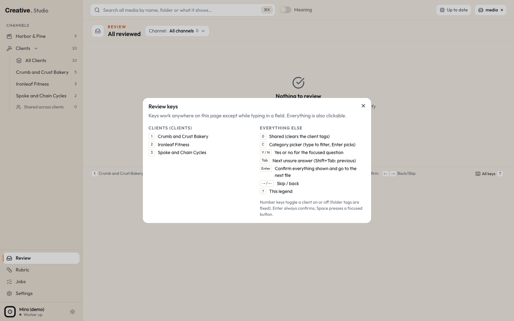

# Describe, classify and review

Three steps turn a folder of files into a Library you can search and filter by what is in them:

1. **Describe**: a vision model on your Mac writes what each image or video shows, and whisper.cpp writes down what is said in the first 15 seconds of each video. Free and local.
2. **Classify**: Jev (TypeSafe) reads each description and files the file: its category, energy, whether it could be a hook, whether it is brand safe and more. Paid, a small amount per file.
3. **Review**: when Jev is unsure about an answer that matters, the file waits in the Review queue for you. Your answers are final.

All three run in the worker in the background. Their state and errors show on the [Jobs](jobs.md) page and in [Settings > AI](settings.md#ai).

## Describe

### What it does

For every image and video in an enabled root, the worker sends the cached previews (never your original files) to the Ollama vision model `qwen3-vl:8b-instruct`:

- an **image**: its thumbnail.
- a **video**: frames from its first 3 seconds and its contact sheet, taken from the cached 480p proxy.

The model answers in a fixed, labelled format: what the first 3 seconds show, what the file shows, the people in it, the setting, any text on screen, and what it looks like. For a video that has sound, whisper.cpp transcribes the first 15 seconds into the **spoken opening** ("No speech" when there is none).

Descriptions feed plain search, search by meaning, Classify and the video hooks on the [Hooks](hooks.md) tab. Audio files are not described.

### When it runs

- One file at a time. Files indexed after Describe first started go first, then the rest of the Library, newest first.
- A file waits until its previews exist (a video needs its poster, contact sheet and proxy).
- Files with the same bytes share one description (Studio describes it once).
- A file whose bytes change is described again. When a new vision model or new describe instructions are in use, every file is due again.
- Describe is on by default on a fresh install.

If Ollama is not running or the model is missing, the queue waits and retries on its own; nothing is marked as failed. A file that fails for another reason keeps its error and is skipped until you retry it.

### Controls

| Where | Control | What it does |
|---|---|---|
| Drawer, **AI description** | **Describe again** | describes this file next, even while Describe is paused, and runs whisper again |
| Settings > AI | **Pause** / **Resume describing** | stops or restarts the backfill and new files (Describe again still works per file) |
| Settings > AI | **Retry N errors** | puts every failed file back in the queue |
| Settings > AI | **Check again** | checks Ollama and whisper again |
| cmd+K | **Pause describing** / **Resume describing** | the same as the Settings buttons |
| Jobs page | **Describe** row, error rows with **Retry** and **Clear** | see [Jobs](jobs.md) |

### Cost and setup

Free. Everything runs on your Mac and reads only Studio's cache. Without Ollama, files stay undescribed; without whisper, videos have no spoken opening. See [Ollama](../integrations/ollama.md) and [whisper.cpp](../integrations/whisper.md).

## Classify

### What Jev is asked

Once a file is described, the worker sends Jev its description (as text; never the file) and a set of questions:

| Question | Asked for | Answer |
|---|---|---|
| **Category** | every image and video | one of 18: Job photo, Before / after, Static ad, Video ad, Hook clip, Intro / outro, Talking head, Testimonial, B-roll, VSL, Episode, Short, Thumbnail, AI render, Screen demo, Brand asset, Reference, Other |
| **Energy** | every image and video | 1 to 5 |
| **Could be a hook** | videos | yes / no: the first 3 seconds could stop a scroll |
| **Brand safe** | every image and video | yes / no: no outside logos, private info or broken frames |
| **Visual format** | static ads | Educational infographic, Headliner, Benefits callout, Comparison (us vs them), Transformation, Grid, Text only or Not an ad |
| **Person clear**, **Pain clear**, **Promise clear** (the Three P's) | static ads and video ads | yes / no each |
| **Clients** | Clients lane files with no folder or manual client tag, where you have not decided the clients yourself | yes / no per client, plus "universal" |

Files in the Brand lane and the Company lane are never asked about clients. The category and format descriptions Jev reads come from your business profile (see [configuration](../configuration.md)); each client's one line hint (Settings > Clients, or its Client tab) helps Jev tell clients apart.

The **Best use** line in the drawer (Reels / Shorts, Feed, YouTube, Static (story) and so on) is worked out from the file's shape, never asked.

### Sure and unsure answers

Every answer comes back with how sure Jev is.

- A category, energy or format answer is **unsure** when its confidence is under the **Confidence threshold** (default 0.70, settable from 0.30 to 0.95 in Settings > AI).
- A yes / no answer is unsure when it sits between 25% and 75% yes.
- Only an unsure **category**, **client group** or **brand safe** answer sends the file to Review. Other unsure answers are only marked (an orange dot) in the drawer and in Review.
- A client Jev is sure about (75% or more) is tagged at once and its chip carries a **Jev** mark.

A new threshold applies to the next files Jev classifies; files already classified keep their marks.

### When it runs

- Two files at a time, one Jev call per file.
- **Classify starts paused on a fresh install**, so you can try a few files (Classify again) before you let it run through your whole Library.
- A file is classified again when its description changes, or when Studio's questions change.
- Before every call Studio checks today's Jev spend against your **daily cap** (default $1, up to $20, set in Settings > AI). When the cap is reached, classify waits until midnight New York time. The cap covers every Jev call: classify, hook scoring and search by meaning.
- No key, a refused key or Jev being down: the queue waits and says why.

### Controls

| Where | Control | What it does |
|---|---|---|
| Drawer, **Jev tags** | **Classify again** | asks Jev about this file next, even while Classify is paused |
| Drawer, **Jev tags** | the category button | pick the right category: it becomes yours and is never overwritten or asked again |
| Drawer, **Clients** | chips and **Tag client** | your client decision; Jev is never asked about this file's clients again |
| Settings > AI | **Pause classify** / **Resume classifying**, **Retry N errors**, Confidence threshold + **Save**, Daily cap (USD) + **Save** | |
| cmd+K | **Pause classifying** / **Resume classifying** | |

### Cost and setup

Paid: one Jev call per file, a fraction of a cent each. Settings > AI shows today's and all time spend, calls, and the rate. You need a Jev key; see [TypeSafe Jev](../integrations/typesafe-jev.md). Without a key nothing is classified, and the Category, Energy and Needs review filters stay empty.

### What your answers change

Your answers win, always:

- A category you pick (drawer or Review) is never overwritten and never asked again.
- A client decision (any change to a file's client chips, or confirming the clients in Review) stops the client questions for that file for good. Folder rule tags stay as they are.
- Every change you make to one of Jev's answers is stored as a correction, and the most recent category and client corrections go along with later classify calls as examples.

## Review

The Review page is the queue of files with an unsure category, client group or brand safe answer, one file at a time, built for the keyboard.

### How to get there

- The **Review** item at the bottom of the sidebar (its badge counts the files waiting).
- cmd+K: **Review queue**.
- The **Needs review** link in a drawer's Jev tags block (`/review?asset=<id>`).
- The **Needs review** filter in the Library shows the same files as cards.

The **Channel** menu at the top filters the queue: All channels, each lane, or one client (`/review?in=rtm`, `/review?in=fkbpros`, `/review?in=fkb`, `/review?in=crumb`).

### The page

Left: the preview, the file name with **Open in Library**, its folder, the AI description and the spoken opening.

Right: **Jev's answers**, one row per question that applies, unsure rows highlighted:

- **Category**: a button that opens the category picker (type to filter, Enter picks).
- **Clients** (Clients lane files): one button per client with Jev's percentage, plus **Shared (no single client)**. A client tagged by a folder rule is fixed here.
- **Energy**: buttons 1 to 5.
- **Visual format**: a menu.
- The yes / no questions: **Yes** and **No** buttons.

At the top right: the position ("3 of 12"), **Back**, **Skip** and **Confirm**.

**Confirm** saves every answer shown (not only the ones you changed), makes the category and the kept client tags yours, clears the review mark and moves to the next file. Edits you make and then skip are kept for that file until you come back to it.

### Keys

The keys work anywhere on the page except while you type in a field. Everything is also clickable.

| Key | What it does |
|---|---|
| 1 to 8 | toggle the client in that position (sidebar order) |
| 0 | Shared (clears the client tags) |
| C | category picker (type to filter, Enter picks) |
| Y / N | yes or no for the focused question |
| Tab | next unsure answer (Shift+Tab: previous) |
| Enter | confirm everything shown and go to the next file |
| → / ← | skip / back |
| ? | the full list of keys |

The strip at the bottom of the page shows the same keys with your clients' names.

When nothing is left, the page says **Nothing to review** (and that Classify is paused, if it is).

## Try it in the demo

The demo has fixed descriptions for every file (written by the demo script, since the demo has no Ollama), so you can read them in each drawer's **AI description** and search them with plain search. Describe and Classify start paused and the demo has no Jev key, so:

- **Describe again** queues the file, and Settings > AI shows Ollama as not reachable.
- The **Jev tags** block says the file is not classified yet. **Classify again** queues it, but nothing is filed without a key.
- The Review queue is empty: open `/review` to see the empty state and press **?** for the key list.
