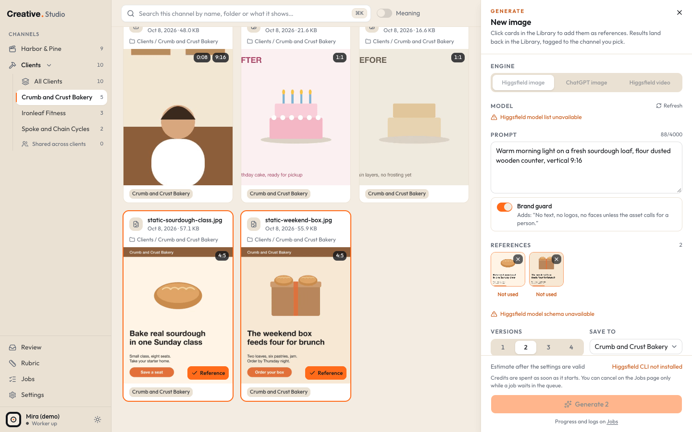

# Generate

Generate makes new images and videos with outside engines and lands the results back in your Library, tagged to the channel you pick. It also has three one click **quick tools** (Upscale, Remove background, Reframe 9:16) that run on a file you already have.

Two engines can do the work:

| Engine | What it makes | How you pay | Setup |
|---|---|---|---|
| Higgsfield | images and videos, plus the quick tools | Higgsfield credits: every run is quoted first and needs one confirm click | [Higgsfield](../integrations/higgsfield.md) |
| ChatGPT image, through Codex | images | included in your ChatGPT plan, not quoted | [Codex](../integrations/codex.md) |

Generation always runs in the worker, never in your browser tab. Settings > Generation engines shows whether each engine is ready.



## How to open it

- The **Generate** button at the top right of every channel.
- cmd+K (or Ctrl+K): **Generate image** or **Generate video**.
- **Use as reference** on a Library card or in the drawer: opens the panel with that file in the tray.
- **Remix** in the drawer of a generated file: opens the panel with that run's settings.

Generate needs your media folder to be available (the results are saved there). While it is not, the button is disabled and its tooltip says why.

The panel sits on the right and leaves the Library clickable next to it.

## The panel

### Engine

Three tabs: **Higgsfield image**, **ChatGPT image**, **Higgsfield video**. A tab that cannot run right now (not installed, not signed in) is greyed out; hover it for the reason.

### Model

Higgsfield's live model list for images or videos: a **Shortlist** first, then **All models**. **Refresh** reloads the list from Higgsfield. The default image model is `gpt_image_2_5` and the default video model `kling3_0`. ChatGPT image always uses GPT Image.

The settings form below is built from the chosen model's own schema, so it shows exactly the options that model takes. Studio starts with 9:16 wherever the model accepts it.

### Prompt and Brand guard

Up to 4,000 characters. **Brand guard** adds one sentence to the prompt: "No text, no logos, no faces unless the asset calls for a person." It is on by default for images and off for video.

### References

Click cards in the Library while the panel is open to add them to the tray (or use a card's **Use as reference** button). References are optional. Each one gets a role from the model:

| Role | Short label in the tray |
|---|---|
| Start frame | Start |
| End frame | End |
| Reference | Ref |
| Video reference | Video ref |

Studio assigns roles in tray order (the first image becomes the start frame when the model has one). When a model offers more than one role for an item, a small menu under it lets you pick. **Not used** means the model has no free slot for it: remove it, or the run is blocked.

Before you can confirm, the panel checks the model's own rules (for example how many images a slot takes) and shows any problem in orange. The server checks the same rules again when you confirm.

A video reference is sent as the original when it is H.264 in an MP4 or MOV under 200 MB. Anything else first gets a 1080p H.264 copy made in the cache (once, then reused).

A reference that sits in a folder Studio treats as proof photos (a folder name ending in ` - Work Gallery`, or containing `Before After`) shows a warning: the AI will redraw it, so the result is not real proof of work.

### Versions and Save to

**Versions**: 1 to 4 results (default 2), one job each.

**Save to**: where the results land. It starts on the channel you are in: the Brand lane, the Company lane, All Clients (shared), or one client.

### The footer and the one confirm

For Higgsfield, the footer shows **Estimated N credits** for the whole run (for example "(2 × 7.5)") and your **Balance**. The quote is taken from Higgsfield for exactly the settings shown; change anything and it quotes again. The button then reads **Spend N credits · generate 2**. That click is the one confirm: credits are spent as soon as a job starts.

For ChatGPT image, the footer says **Included in your ChatGPT plan**, about a minute per image, two at a time, and the button reads **Generate 2 · ChatGPT plan**.

When the button is disabled, hover it for the reason ("Write a prompt first", "Getting the cost", a rule problem, the engine's problem).

## Where the results land

Results are saved inside your media folder, the only place Studio ever writes there:

```text
<media folder>/Studio Generated/<Brand lane folder>/
<media folder>/Studio Generated/<Clients lane folder>/<client code>/
<media folder>/Studio Generated/<Clients lane folder>/_shared/
<media folder>/Studio Generated/<Company lane folder>/
```

The lane folder names come from your business profile (`generated`, by default `Brand`, `Clients` and `Company`; see [configuration](../configuration.md)). Folders are made the first time something lands in them.

File names: `<yyyy-mm-dd>_<engine>_<model>_<prompt words>_<n>.<ext>`; quick tools use `<yyyy-mm-dd>_<engine>_<tool>_<source file name>_<n>.<ext>`. A name that is taken gets `-2`, `-3` and so on: an existing file is never overwritten.

Next to every result sits a sidecar, `<same name>.gen.json`, with the full request: engine, model, prompt, every setting, the references, the destination and the quoted credits. The drawer's **Generation** section reads it.

Every result is indexed like any other file and carries a **Generated** badge. The Library's **Source** filter (All, Generated, Originals) finds them.

## Quick tools

One click tools on a Library image or video, all on Higgsfield credits:

| Tool | On an image | On a video |
|---|---|---|
| **Upscale** | Upscale 4k | Upscale 2k |
| **Remove background** | yes | yes |
| **Reframe 9:16** | extends the image to 9:16 | the reframe workflow at 720p, for clips up to 10 minutes |

Open them from a card's wand button, the drawer's **Quick tools** row, or cmd+K while a drawer is open (**Quick tools · file name**).

Every tool opens one confirm dialog: the tool, the source file, the quote, your balance, and a button like **Spend 2 credits · upscale**. The result lands in the source's own channel: a Clients lane file tagged to exactly one client goes to that client's folder, any other Clients lane file to `_shared`.

Two notes the dialog can show:

- **At least N credits.** Higgsfield quotes video upscale and video background removal without the clip's length, so the real charge may be higher: "Estimate may be low: Higgsfield quotes this without the clip length".
- **First real run.** The video tools had never run for real when they shipped. The note stays until one job of that tool on a video has finished. If Higgsfield rejects it before starting, no credits are spent.

## Cancel and Retry

Every run shows on the [Jobs](jobs.md) page under **Generations** with its status, log, cost and outputs.

- **Cancel** works on any generation while it is still waiting in the queue: nothing has started, nothing is spent.
- A running ChatGPT image job can be cancelled too; the worker stops it within a few seconds.
- A running Higgsfield job cannot be cancelled: its credits were spent when it started. The row says "Can't cancel: credits already spent".
- **Retry** on a failed Higgsfield job that already has a Higgsfield job id downloads it again for free. Without one, Retry creates a new job and spends credits again; the button says so (**Retry · spends N credits**). If Studio could not tell whether the first job was created, the row warns you to check Higgsfield first.
- **Retry** on a ChatGPT image job runs it again on your plan.

Higgsfield runs three jobs at a time, ChatGPT image two.

## Remix

In the drawer of a generated file, **Remix** reopens the panel with the same engine, model, prompt, settings, references and destination. References that are no longer in the Library are left out (a short note says how many). For a quick tool output, the button is **Run again** and reopens that tool's confirm on the same source.

## Discard

In the drawer of a generated file, **Discard** asks "Discard this file?" and **Move to Trash** sends the file and its `.gen.json` sidecar to the macOS Trash. You can put them back from the Trash; the next scan finds the file again.

Discard only works on files Studio generated inside `Studio Generated/`, and only while the media folder is available. Nothing else in your media can be discarded. On an external drive, macOS keeps the trashed file in that drive's own Trash folder, which Finder shows in the Trash.

## What it costs

| Action | Cost |
|---|---|
| Opening the panel, model lists, quotes, balance | free |
| Higgsfield image or video | the quoted credits, after one click on the Spend button |
| Quick tools | the quoted credits (a minimum for video upscale and video background removal), after one confirm |
| ChatGPT image | included in your ChatGPT plan |
| Retry of a Higgsfield job with a job id | free |
| Retry of a Higgsfield job without one | the credits again |

## Keyboard

| Keys | What it does |
|---|---|
| cmd+K, then "Generate image" or "Generate video" | open the panel on that engine kind |
| cmd+K with a drawer open | the open file's quick tools |
| Esc | close the quick tool dialog |

## Try it in the demo

The demo switches every engine off (`STUDIO_ENGINES=off`), so it never spends anything even if Higgsfield or Codex is installed on your Mac. You can still:

1. Click **Generate** in any channel and look around the panel: the engine tabs show as unavailable with the reason.
2. Click a card while the panel is open to see it land in the reference tray.
3. Open a card's wand menu: the quick tools are disabled with the reason.

The demo has no generated files, so the Generation section, Remix and Discard do not appear there. To try Generate for real, set up [Higgsfield](../integrations/higgsfield.md) or [Codex](../integrations/codex.md) on a real install.
