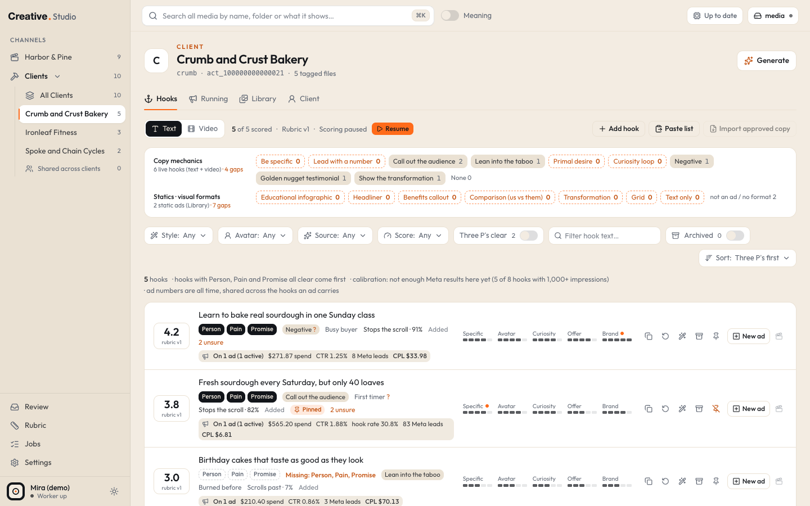
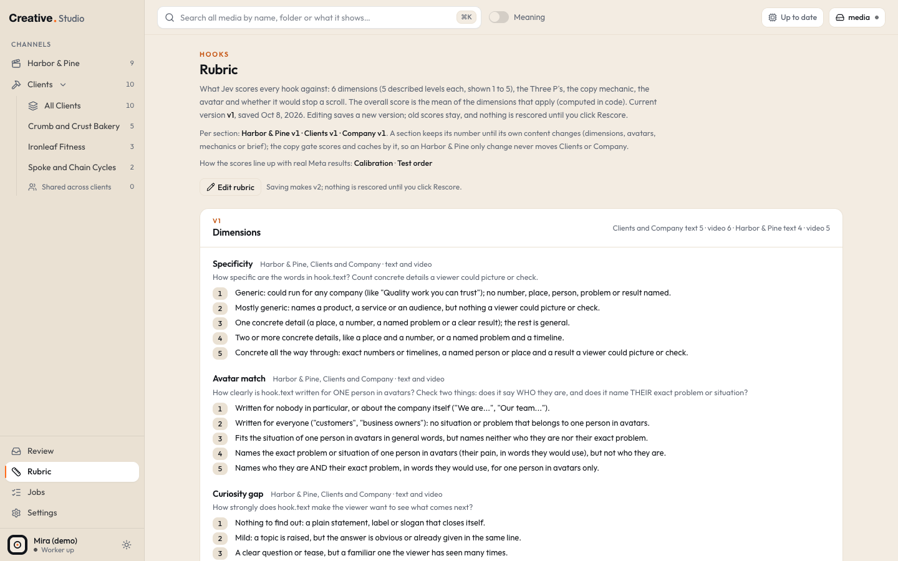
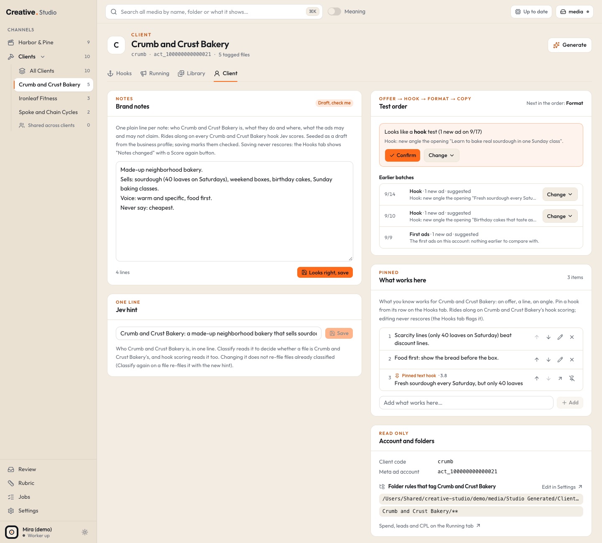

# Hooks, the Rubric and the Client tab

A hook is the opening line or opening seconds of an ad, a reel or a post. Studio keeps a list of hooks per channel, has Jev (TypeSafe) score every one against a written rubric, and lets you ask the claude CLI for new versions of a hook. Three places work together:

- the **Hooks tab** of every channel: the hooks themselves, their scores, filters, coverage and rewrites;
- the **Rubric** page: what the scores mean, your notes, calibration against real results, and every rubric version;
- the **Client tab** of each client and of the Company lane: brand notes, the one line hint, What works here and the test order.

## Where it is

| Channel | Hooks tab | Client tab |
|---|---|---|
| The Brand lane | `/rtm/hooks` | (none) |
| All clients of the Clients lane (includes shared hooks) | `/fkbpros/all/hooks` | (none) |
| One client | `/fkbpros/crumb/hooks` | `/fkbpros/crumb/client` |
| The Company lane | `/fkb/hooks` | `/fkb/client` |
| Every channel | | Rubric page: `/rubric` (sidebar **Rubric**) |

cmd+K (or Ctrl+K) entries: **Add hook** and **Paste hooks** (in the channel you are in, or it asks which channel), **Rubric**, **Client notes · (client)**, **Test order · (client)**, **Calibration**, **Pause hook scoring** / **Resume hook scoring**.

## The Hooks tab

### Text and Video

Two views at the top left. **Text** lists written hooks; **Video** lists video hooks (one per video). A small orange number on a view counts its hooks with variants waiting for your Keep or Discard.

Next to them: "N of M scored", the current rubric version, and the scoring state (Scoring paused, Scoring…, Waiting: why, Worker offline, Scoring on) with **Resume** or **Pause**. While paused, Resume shows how many hooks wait and roughly what scoring them costs.

### Adding text hooks

| Button | What it does |
|---|---|
| **Add hook** | one hook, stored exactly as typed (2 to 500 characters) |
| **Paste list** | one hook per line, up to 500 at a time; blank lines and hooks this channel already has are skipped, and a leading "-" or "1." list marker is dropped |
| **Import approved copy** (one client's tab) | reads that client's approved copy file and adds every headline and the first sentence of every primary text, tagged with its angle. Safe to run again: hooks already in the channel (archived ones too) are skipped |

Import approved copy needs the client's **Folder** set in Settings > Clients and exactly one `*-ad-copy-final.md` in that folder; otherwise the button is off and its tooltip says why. The file format is on [client files](../formats/client-files.md).

On All Clients, an added hook is **shared** (not tied to one client).

Hooks also arrive on their own:

- **From Meta**: after each Meta sync, every ad headline and the first sentence of every primary text becomes a hook in its channel (or links to the same hook if it exists). See [Running](running.md).
- **From an episode**: Shorts board moments make Brand lane hooks from their first line and cold open. See [Shorts](shorts.md).
- **Variants** you keep (below).

### Video hooks

The worker checks every 15 seconds and makes a video hook, once the video is described, for:

- every video Jev says **Could be a hook** with 75% or more (or that you marked yes in Review), and
- every Clients lane video in a folder named `Intro/` (never in `Outro/` or `Outtro/`).

Any other video: open it in the Library and click **Add as hook** in the drawer. The hook's line comes from the video's first spoken sentence, else its on screen text, else the opening description. Video rows show the poster (hover to play the proxy), **Said:** and **On screen:**, and open the drawer when clicked.

### A hook row

| Part | What it shows |
|---|---|
| The number on the left | the **overall** score, 1 to 5: the mean of the dimension levels that apply. Under it, the rubric version it was scored on (an older version shows in orange) or "not calibrated" on Brand lane hooks |
| The text | the hook (video rows: the line, plus Said and On screen) |
| P pills | **Person**, **Pain**, **Promise**: dark when clear (50% yes or more). Missing ones are named in orange ("Missing: Pain") |
| Style | the copy mechanic Jev reads in it |
| Avatar | which of the rubric's avatars it speaks to, or No avatar |
| Stops the scroll / Scrolls past | Jev's yes / no on whether it would stop a scroll |
| Bars | one small bar per dimension, 1 to 5. An orange dot marks an unsure answer |
| Ad numbers | when the hook runs on Meta ads: spend, CTR, hook rate, leads and CPL summed over those ads, all time, linking to the Running tab filtered to them |
| Short numbers | Brand lane video hooks cut into YouTube Shorts: views, % viewed, likes, subscribers |

Row buttons: **Copy**, **Score again** (one Jev call, a fraction of a cent), **Rewrite variants**, **Archive** / **Restore**, the pin (**Pin to What works here**, client and Company lane hooks), **New PAUSED ad from this hook** (Clients and Company lanes; see [Running](running.md#new-paused-ad)) and **Send to Shorts** (Brand lane; see [Shorts](shorts.md)).

### Filters and sort

| Control | URL key |
|---|---|
| **Style**: a copy mechanic | `style` |
| **Avatar**: an avatar, or None / other | `avatar` |
| **Source** (Text view): Added, Pasted, Approved copy, Variant, From Meta, From an episode | `source` |
| **Score**: 3.5 to 5 (strong), 2.5 to 3.4, 1 to 2.4 (weak), Not scored yet | `band` |
| **Undecided variants**: only hooks with variants waiting | `undecided=1` |
| **Three P's clear**: only hooks with Person, Pain and Promise all clear | `pp=1` |
| the text box: filter by the hook's words (Video view: also file name and speech) | `hq` |
| **Archived**: show archived hooks instead | `archived=1` |
| **Sort**: Three P's clear first, then score (the default); Score only; Newest first; Style (copy mechanic); Avatar; Spend on its Meta ads; CTR of its Meta ads | `sort` |

The default sort puts hooks with all three P's clear first, by score; then scored hooks missing a P; then unscored ones. The score itself is never lowered for a missing P. The list shows 15 hooks a page.

The line above the list also links to **Calibration** on the Rubric page with how many of this channel's hooks have enough Meta results.

### Coverage

The coverage strip counts the channel's live hooks per **copy mechanic** and, for the Clients and Company lanes, its static ads per **visual format** (from Classify). A zero shows as an orange gap: a mechanic or format you have not tried yet. The Rubric page shows the same counts for every channel.

### Scoring

- Hook scoring runs in the worker, two hooks at a time, one Jev call per hook, inside your daily Jev cap.
- **Hook scoring starts paused on a fresh install.** New hooks wait until you resume it; **Score again** on a row still runs while paused.
- What Jev reads: the hook, the rubric, the channel's brief, its notes (the Brand lane notes or the client's brand notes), the client's one line hint, What works here, the who's who note and, for a video, its opening, on screen text and spoken line.

**Notes changed.** Editing notes, the hint or What works here never rescores anything by itself. Hooks scored with the old text show a banner: "Notes changed since these were scored: N hooks (...). Nothing rescores until you click." with **Score again (~$cost)**. A video described again after its score shows the same banner.

### Rewrite variants

The wand button on a row opens **Rewrite variants**. Type an optional one line steer (up to 200 characters), then **Write 5 variants**:

1. The claude CLI, signed in to your own Claude subscription, writes 5 new versions, each on a different copy mechanic, aimed at the hook's weakest scores and keeping its avatar and promise. Video hooks get opening lines to film or say.
2. Studio checks each one in code against your copy rules (your profile's dash policy, banned client names, "Never say" and "Claims not allowed" lines in the notes, AI tell phrases). A variant that fails is dropped; if fewer than 3 survive, claude gets one more try.
3. The survivors are scored by Jev (even while scoring is paused) and wait under the hook, ranked the same way as the list.
4. **Keep** makes a variant a normal hook in this channel. **Discard** archives it for good.

Cost: one claude run on your subscription (usually under 15 seconds) and Jev scoring of about $0.001. The job shows on the [Jobs](jobs.md) page under **Hook variants**, with Cancel while it waits and Retry after an error. See [claude CLI](../integrations/claude-cli.md).

## The Rubric page

`/rubric`, from the sidebar's **Rubric** item.

### What the rubric is

Every hook is scored on:

- **Dimensions**, each a question with 5 described levels, shown 1 to 5. Each dimension applies to some lanes and to text hooks, video hooks or both. A fresh Studio starts with a starter rubric (for example Specificity, Avatar match, Curiosity gap, Offer clarity, Visual stop power on video, Brand fit).
- **The Three P's**: is the Person, the Pain and the Promise clear (yes at 50% or more)?
- **The copy mechanic** the hook leans on most (Be specific, Lead with a number, Call out the audience, Lean into the taboo, Primal desire, Curiosity loop, Negative, Golden nugget testimonial, Show the transformation, or None).
- **The avatar**: which of the lane's avatars (each with a Person, Pain and Promise) it speaks to.
- **Stops the scroll**: yes or no.

The **overall** score is the mean of the dimensions that apply, worked out in code.

### Versions and Rescore

**Edit rubric** turns the page into an editor. You can change dimension labels, short labels, which lanes and hook kinds they apply to, the question Jev reads and the five levels; add or remove dimensions; edit the copy mechanic definitions (not their names); and edit or add avatars per lane. Write a note about what changed, then **Save vN**.

Saving makes a **new version**; the old version and every score made with it stay. Nothing is rescored when you save. A banner then says how many hooks would be rescored and about what it costs in Jev, inside the daily cap. Click **Rescore** (or **Rescore and resume scoring**, while scoring is paused, which also scores the hooks that were never scored) when you are ready. Until then every hook keeps its older score, labelled with its version.

The Rescore button covers every lane. The page also shows each lane's own version number: a lane keeps its number until its own part of the rubric changes. When only the Brand lane's part changed, its Hooks tab offers **Rescore (Brand lane) hooks on vN**, which rescores that lane only.

**Version history** lists every version, when it was saved, how many hooks it scored, and whether its Rescore was clicked.

### Notes on the Rubric page

- **(Brand lane) notes**: what Jev reads about your own brand when scoring Brand lane hooks. **Edit**, then **Save**.
- **Who's who**: people and names, one per line. Read by hook scoring and search by meaning.
- **Channel briefs**: the one paragraph per lane that Jev reads as the channel's brief (part of the rubric version).
- **Brand notes**: every client's and the Company lane's notes, read only here; edit them on the Client tab.

Seeded notes show **Draft, check me** until you save them once. Saving notes flags the hooks scored with the old text; nothing rescores until you click.

### Coverage

Two tables, every channel: live hooks per copy mechanic, and static ads per visual format.

### Calibration

Calibration checks whether high scores actually went with better results. It needs real results: hooks linked to Meta ads (Clients and Company lanes) or to YouTube Shorts (the Brand lane).

- For each dimension, the overall score, the Three P's and Stops the scroll, Studio ranks the hooks by score and by result and shows how well the two rankings agree, from +1 (higher scores always went with better results) through 0 (no link) to negative.
- Results: CTR, hook rate and CPL (Clients and Company lanes; lower CPL counts as better); views and average % viewed (the Brand lane, from YouTube Shorts).
- A hook counts once it has enough data (by default 1,000 impressions for CTR and hook rate, 3 leads for CPL, 300 views for Shorts). A cell needs at least 8 such hooks on at least 8 different ad groups, else it says "Not enough data yet". All of these minimums are in Settings > Meta and GHL.
- Pick a rubric **version**, a **view** (Overall, each client, Shared, the Company lane, the Brand lane), and the metric for **Biggest misses**: hooks that scored high but did poorly, and low scorers that did well.

Calibration is free (no Jev call). It reports; it never changes a score. The URL keys are `cal_v`, `cal_view` and `cal_m`.

### Test order

A table of every channel's last tested variable, when, and the next one in the order offer, then hook, then format, then copy. Details and the Confirm button live on each Client tab (below).

## The Client tab

### Brand notes

One plain line per note: who the client is, what they sell and where, what the ads may and may not claim. They go along with every one of this client's hooks Jev scores. Up to 4,000 characters. Notes seeded from your business profile show **Draft, check me** and a **Looks right, save** button until you save them once; after that the button is **Save notes** (and **Revert** while you have unsaved edits).

Lines like "Never say ...", "Never name ..." and "Claims not allowed: ..." also feed the copy rules that check variants and new ads.

### Jev hint

One line (up to 300 characters) about who the client is. Classify reads it to decide whether a file belongs to this client, and hook scoring reads it too. Changing it does not re-file files already classified; **Classify again** on a file re-files it with the new hint. On the Company lane's tab, only hook scoring reads it.

### Account and folders

Read only: the client code, the Meta ad account, the lead source, the Library folders and the folder rules that tag this client, with links to Settings and to the Running tab.

### What works here

What you know works for this client: an offer, a line, an angle. Up to 40 items of up to 300 characters. Add one in the box at the bottom, or pin a hook from its row on the Hooks tab. Items can be edited, moved up and down, and removed; pinned hooks link back to their row and can be unpinned.

What works here goes along with this client's hook scoring. Editing it never rescores; the Hooks tab flags the hooks scored before the change. A pinned hook that was archived, whose video is gone or that moved to another client stays in the list, struck through with the reason.

### Test order

Studio groups each account's new Meta ads by the day they were created and suggests what each batch tested: a new **offer** (a new call to action or landing page), a new **hook** (a new angle), a new **format** (the same angle in a new file), new **copy**, or nothing new. The newest batch asks you to **Confirm**; **Change** lets you pick what it really tested (offer, hook, format, copy or not a test) on any batch. Your answer is never overwritten. The card's header names the next variable in the order.

## What it costs

| Action | Cost |
|---|---|
| Adding, pasting, importing hooks, coverage, calibration, notes | free |
| Scoring a hook (new hooks, Score again, Rescore) | one Jev call per hook, a fraction of a cent, inside the daily cap |
| Rewrite variants | one claude run on your Claude subscription, plus Jev scoring of the variants (about $0.001) |

Settings > AI shows Jev spend per purpose, today and all time.

## Try it in the demo

The demo has about a dozen hooks per lane and four video hooks, every one with a stored score made of fixed demo answers (no Jev call was made).

1. Open `/fkbpros/crumb/hooks`: scored rows with bars, P pills, styles and avatars; one hook is pinned. Try the **Three P's clear** filter and the **Score** filter.
2. Switch to **Video**: the baker clip's hook, with **Said:** and **On screen:**.
3. Open `/fkbpros/crumb/client`: the brand notes, the hint, and What works here with two written items and the pinned hook. The Test order card has the batches the worker found in the demo's made-up ads when it started: try **Change**.
4. Open `/rubric`: the starter rubric, the notes and coverage tables.
5. On a hook with Meta ads (for example on `/fkbpros/ironleaf/hooks`), the ad numbers link to the Running tab.

What the demo cannot do: scoring is paused and there is no Jev key, so **Score again** and new hooks only queue. **Rewrite variants** needs the claude CLI, which the demo switches off. Calibration says "Not enough data yet": the demo has too few hooks and ads.
