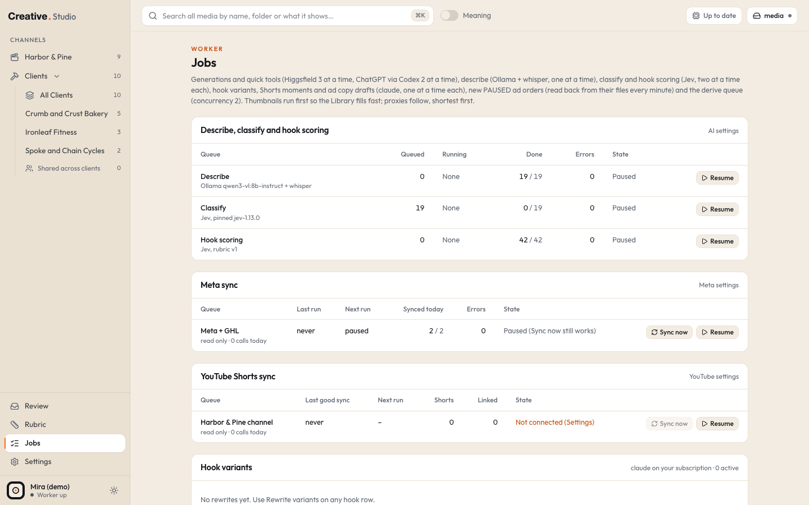

# Jobs

The Jobs page shows what the worker is doing and has done: making previews, describing, classifying, scoring hooks, reading Meta and YouTube, running claude, staging ad orders and generating. It is also where you retry, cancel and clear things.

The worker is the background process that does all of this. The web app only shows the results; if the worker is not running, the top bar says **Worker offline** and nothing in this page moves.

## Where it is

`/jobs`, from the sidebar's **Jobs** item. The item shows a count of queued and running preview jobs, or an orange "N err" when errors are waiting. The top bar's worker pill ("N queued", "Up to date" or "Worker offline") also links here. cmd+K (or Ctrl+K): **Jobs**, and **Ad orders** (jumps to that list).

The page refreshes itself every few seconds.

## The parts of the page, top to bottom

### Clear all errors

**Clear all errors (N)** at the top hides every error shown on the page. Nothing is retried, cancelled or changed. See [Clear](#clear) below.

### Describe, classify and hook scoring

One row per background AI queue, never one row per file:

| Queue | Engine |
|---|---|
| **Describe** | Ollama and whisper.cpp, on your Mac ([Describe](describe-classify-review.md#describe)) |
| **Classify** | Jev ([Classify](describe-classify-review.md#classify)) |
| **Hook scoring** | Jev, on the current rubric version ([Hooks](hooks.md)) |

Columns: Queued, Running (the file or hooks being worked on), Done, Errors, State (Running, Waiting: why, Paused, Idle, Worker offline). Each row has **Retry all N** (when it has errors) and **Pause** / **Resume**. The **AI settings** link opens Settings.

Under the table, one line per failed file or hook with its error, **Retry** (describe or classify it again, or score it again) and **Clear**.

### Meta sync

One row for **Meta + GHL**: the last run, the next run (6:00 PM New York time, or "paused"), how many accounts synced today, errors and the state. **Sync now** reads every account now, even while paused; **Pause** / **Resume** holds or restarts the daily read. Under it, one line per ad account with an error (the last good sync, the last try, the error) and **Clear**. See [Running](running.md) and [Meta](../integrations/meta.md).

### YouTube Shorts sync

The same for YouTube: the last good sync, the next run (6:00 AM New York time), how many Shorts and how many are linked to a file, the state ("Not connected (Settings)", "Reconnect needed (Settings)", Syncing, Paused, Idle), **Sync now** and **Pause** / **Resume**. A failed attempt shows its error with **Clear**. See [Shorts](shorts.md) and [YouTube](../integrations/youtube.md).

### Hook variants

Every Rewrite variants job: the hook, your steer, the status, how many variants survived the copy checks, and a **Log** you can open. **Cancel** while it waits; **Retry** after an error or a cancel (one more claude run). See [Hooks](hooks.md#rewrite-variants).

### Short moments

Every New short job: the episode, how many moments were kept of those claude returned, and the log. The header also counts how many episodes have a word timed transcript. A job waiting for its transcript says so. **Cancel** while it waits; **Retry** after an error or a cancel. See [Shorts](shorts.md#new-short).

### Ad orders

Every new PAUSED ad you staged: its name (a preview until the ad is applied, "the number is assigned when applied"), its status (staged, being applied with the step, applied, failed, cancelled, order file missing), the media file, the order file's path, and **In Running** once the next Meta sync has the ad. **Cancel** works only while an order is staged: Studio rewrites its own file as cancelled. See [Running](running.md#new-paused-ad) and [ad orders](../formats/ad-orders.md).

### Ad copy drafts

Every **Draft the rest** job from the New PAUSED ad dialog: the hook, the status and the log. **Cancel** while it waits; **Retry** after an error or a cancel.

### Generations

Every Generate run and quick tool: the prompt (or the tool and its source file), the engine, the model, which version of how many, where it is saved, the credits, how long it took, the outputs (each links to its file) and the **Log** (open while it runs). The cancel and retry rules:

| State | Button | What it costs |
|---|---|---|
| waiting, any engine | **Cancel** | nothing: it never started |
| running, ChatGPT image | **Cancel** | nothing: it stops within a few seconds |
| running, Higgsfield | none ("Can't cancel: credits already spent") | the credits were spent at start |
| failed, Higgsfield, with a job id | **Retry** | free: it downloads the same job again |
| failed or cancelled, Higgsfield, no job id | **Retry · spends N credits** | the credits again; a warning shows when the first job may exist on Higgsfield |
| failed or cancelled, ChatGPT image | **Retry** | runs again on your ChatGPT plan |

A video quick tool that had never run for real shows **First real run**. See [Generate](generate.md#cancel-and-retry).

### Previews (the derive queue)

The bottom half is about previews:

- four counters: **Assets done**, **Assets pending**, **Assets with errors**, **Jobs running**;
- a table of the two preview job types, **Poster + sheet / thumb** and **480p proxy**, by status (pending, running, done, error);
- **Running now** and **Up next**;
- **Recent errors**, each with its file (a link to its drawer), the job type, when, the attempt number and the error, plus **Retry** and **Clear**; **Retry all N** puts every failed preview job back in the queue;
- **Recently finished**.

Thumbnails and posters run first, then proxies, shortest video first, two at a time. Retry all touches preview jobs only, never a generation.

## Clear

**Clear** on an error line hides it; **Clear all errors** hides every error on the page. A cleared error:

- leaves the Jobs lists, the error counts, the sidebar's "err" badge and **Retry all**;
- stays hidden only while its error text stays the same: a new, different error on the same file, hook or account shows again;
- changes nothing else. The file, hook or account is not retried, and a cleared describe, classify or hook error is still skipped by its queue until you retry it.

## Log files

Every claude and generation job writes its own log in Studio's logs folder (`STUDIO_LOGS`, by default `logs` in Studio's data folder):

| Job | Log file |
|---|---|
| Generate and quick tools | `logs/jobs/gen-<id>.log` |
| Rewrite variants | `logs/jobs/hook-variants-<id>.log` |
| New short | `logs/jobs/short-moments-<id>.log` |
| Draft the rest | `logs/jobs/ad-copy-<id>.log` |

The Jobs page shows the end of each one under **Log**. Error lines in the page are kept short on purpose; the full detail is in the log file and the worker's own log. When Studio runs as a background service, the web app and the worker log to `web.log` and `worker.log` in the same logs folder. See [troubleshooting](../troubleshooting.md).

## What it costs

Looking at the page is free. The costs are those of the jobs themselves: **Retry** on a classify or hook score error is one more Jev call; **Retry** on a claude job is one more run on your subscription; generation retries are in the table above.

## Try it in the demo

Open `/jobs` in the demo:

- the AI queues table shows Describe, Classify and Hook scoring **Paused**;
- **Meta sync** is paused, and **Sync now** has no token to read with;
- **YouTube Shorts sync** says "Not connected (Settings)";
- **Short moments** lists one finished job, written by the demo script (its note says so);
- the preview counters show the demo files done, with their posters, contact sheets and proxies made by the worker in the first seconds.

There are no generations, variants, ad orders or drafts in the demo unless you make some.
