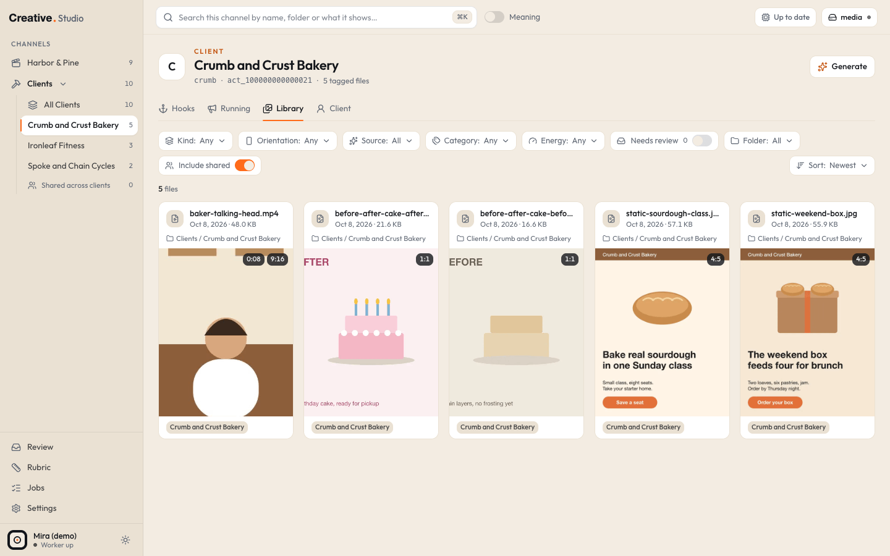
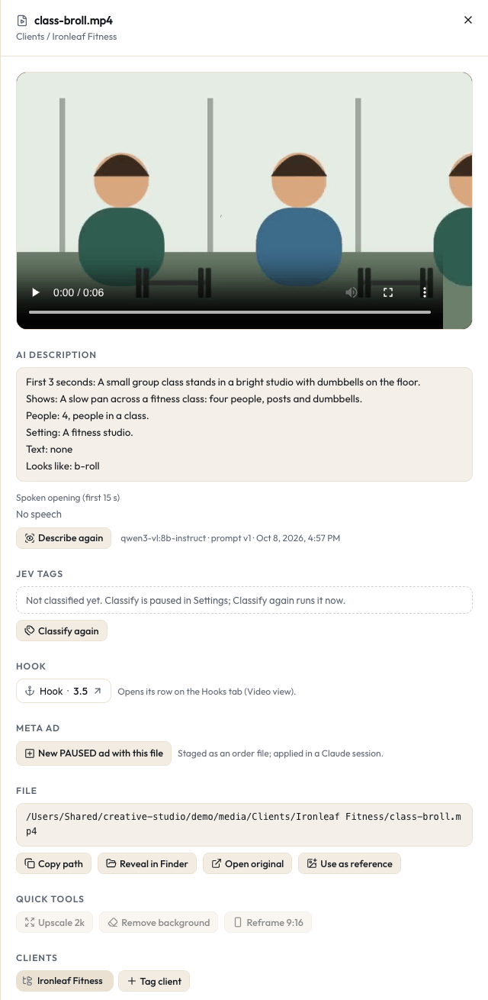

# Library

The Library is where you browse every image, video and audio file Studio has indexed. Studio reads your media folders, makes small previews of every file in its own cache, and shows them as cards you can filter, search and open. It never moves, renames or deletes your media.

## Where it is

Every channel has a Library tab:

| Channel | URL (demo example) |
|---|---|
| The Brand lane | `/rtm/library` |
| All clients of the Clients lane | `/fkbpros/all/library` |
| One client | `/fkbpros/crumb/library` |
| The Company lane | `/fkb/library` |
| Every channel at once (search results) | `/search` |

The sidebar lists the channels under **Channels**: the Brand lane, the Clients group (click it to fold it open: **All Clients**, then each client, then a **Shared across clients** count) and the Company lane. Lane names are yours to change in Settings > Lanes; see [configuration](../configuration.md) for what the internal keys `rtm`, `fkbpros` and `fkb` in the URLs mean.

In the command palette (press cmd+K, or Ctrl+K), type a channel or client name to jump to its Library, or type two or more letters of a file name to see matching files under **Files**.

The Company lane's Library starts with a "No ... folder yet" note until you add a folder for it in Settings > Roots.

## Where the files come from

### Roots

A root is a folder Studio indexes. You add roots in [Settings > Roots](settings.md#roots): paste an absolute folder path, pick the lane it belongs to, click **Add root**. The worker scans it within a few seconds. A root can be switched off (its files leave every list) and on again.

Studio refuses a root that is your whole disk, your home folder, a folder inside Studio's own data, or a folder that overlaps an existing root. A new Studio already has three roots: the `Studio Generated` folder of each lane inside your media folder, where [Generate](generate.md) saves its results (they are made the first time something lands in them). Folders listed in your Studio config file are added as roots once, on the first start.

The worker indexes these file types:

| Kind | Extensions |
|---|---|
| Video | `.mp4`, `.mov`, `.m4v` |
| Image | `.jpg`, `.jpeg`, `.png`, `.webp`, `.heic`, `.gif` |
| Audio | `.m4a`, `.wav`, `.mp3`, `.aac` |

### Scanning and watching

The worker scans every enabled root when it starts, then watches the folders for changes. A new, renamed or moved file shows up on its own. A renamed or moved file keeps its tags (Studio recognizes it by a fingerprint of its bytes).

A file only counts as gone when its root is readable and the file is not there. If your media drive is unplugged (or your media folder is not available), nothing is marked missing: the Library keeps browsing from the cache and a banner says the drive is not available.

### Previews in the cache

For every file the worker makes small copies in its cache folder (never next to your media):

| File | What it is |
|---|---|
| `thumb.webp` | the thumbnail of an image |
| `poster.jpg` | the poster frame of a video |
| `sheet.jpg` | a contact sheet of frames across a video |
| `proxy.mp4` | a 480p H.264 copy of a video, for playback in the browser |

Thumbnails and posters are made first so the grid fills fast; proxies follow, shortest video first, two at a time. Progress is on the [Jobs](jobs.md) page. A card says **Making preview…** until its thumbnail exists and **No preview** if making it failed.

## The filter bar

Every filter lives in the page URL, so a filtered view can be bookmarked and the browser's Back button works.

| Control | What it does | URL key |
|---|---|---|
| **Kind** | Any, Video, Image or Audio | `kind` |
| **Orientation** | 9:16, 4:5, 1:1, 16:9 or Other | `orient` |
| **Source** | All, Generated (made in Studio) or Originals | `source` |
| **Category** | one or more of the 18 categories Jev files things into (Job photo, Before / after, Static ad, Video ad, Hook clip, Intro / outro, Talking head, Testimonial, B-roll, VSL, Episode, Short, Thumbnail, AI render, Screen demo, Brand asset, Reference, Other) | `cls` |
| **Energy** | 1 to 2 (calm, low), 3 (medium) or 4 to 5 (high) | `energy` |
| **Needs review** | only files with an unsure Jev answer waiting in [Review](describe-classify-review.md#review) | `review=1` |
| **Folder** | a root or a folder inside it (type to find one) | `folder` |
| **Clients** (All Clients view only) | Shared (no client) and any clients | `clients` |
| **Include shared** (one client's view only) | show the Clients lane files that have no client tag | `shared=0` when off |
| **Clear** | resets every filter and the search | |
| **Sort** | Newest first, Name A to Z, Longest first, Largest first | `sort` |

Each option shows how many files it would leave. Category and Energy come from [Classify](describe-classify-review.md), so they stay empty until files are classified.

The Library shows 15 cards a page. Below the grid, "Showing 16 to 30 of N" with Prev, page numbers and Next; the page is in the URL as `page`, and any filter change goes back to page 1.

## Cards

Each card shows the file name, its date and size, the folder it sits in, and over the preview its duration and orientation. Badges on the preview:

- **Generated**: made by Studio's [Generate](generate.md).
- **Review**: a Jev answer about this file waits in Review.

On a Clients lane card, the footer shows its client chips, or **Shared** when it has none. A chip Jev added carries a small **Jev** mark.

Hover a video card for a quarter of a second and its 480p proxy plays, muted (or its contact sheet shows while the proxy is still being made).

Hover a card to show its buttons:

- **New ad** (in a client channel or the Company lane, on images and videos): opens the New PAUSED ad dialog with this file. See [Running](running.md#new-paused-ad).
- The wand button: the [quick tools](generate.md#quick-tools) menu.
- **Use as reference**: opens the Generate panel with this file in its reference tray.

Click a card (or its file name, with the keyboard) to open the drawer. While the Generate panel is open, a click adds the card as a reference instead.

## The drawer

The drawer slides in from the right. Its URL key is `asset`, so a drawer link can be shared inside your own Studio.

From top to bottom:

- **Preview.** Videos play their proxy (or the original, when it is an MP4 the browser can play and the proxy is still pending). Images show the original when the browser can show it, else the thumbnail. Audio plays from the original.
- **AI description.** What the local vision model saw and, for a video, the **Spoken opening (first 15 s)**. **Describe again** queues it to be described next. See [Describe](describe-classify-review.md#describe).
- **Jev tags.** The category (with a picker to correct it), energy, visual format, the yes / no answers, **Best use** (worked out from the file's shape, never asked), Jev's client proposals, and **Classify again**. A **Needs review** link opens the file in Review. See [Classify](describe-classify-review.md#classify).
- **Hook** (videos). If the video already has a hook, a link to its row on the Hooks tab with its score. If not, **Add as hook** adds it to its channel's Hooks tab (Video view); it needs the video's description first. See [Hooks](hooks.md).
- **Meta ad** (Clients lane and Company lane images and videos). **New PAUSED ad with this file**. See [Running](running.md#new-paused-ad).
- **File.** The full path, **Copy path**, **Reveal in Finder** (opens a Finder window with the file selected), **Open original** (in a new browser tab), **Use as reference**. The last three need the drive.
- **Quick tools.** Upscale, Remove background, Reframe 9:16. See [Generate](generate.md#quick-tools).
- **Generation** (generated files only). The prompt, engine, model, settings, cost, when, where it was saved and the references used. **Remix** reopens the Generate panel with the same run; a quick tool output shows **Run again** instead. **Discard** moves the file to the macOS Trash. See [Generate](generate.md#discard).
- **Clients** (Clients lane files). The client chips: a folder icon means a folder rule set it (change the rule in Settings); a chip you or Jev set has a remove button. **Tag client** adds one. Any change here is your decision about this file's clients, and Jev is never asked about its clients again.
- **Details.** Kind, codec, dimensions, orientation, duration, frame rate, size, modified, created, indexed, the state of its previews, the last preview error and its fingerprint.

## Searching

### Plain search

The search box at the top searches the Library you are in, by file name, folder, and the words in each file's AI description and spoken opening. It is instant and free. Outside a Library, pressing Enter takes you to `/search` over every channel. The text sits in the URL as `q`.

### Search by meaning

Switch on **Meaning** next to the search box, type what you are looking for in plain words, and press Enter. Jev (TypeSafe) then ranks the described files in this channel and its current filters by how well they match what you typed.

- Results show best first, each with a match percentage. Weaker matches wait behind **Show weaker matches (N)**.
- The line above the results says how many files Jev ranked and how many were left out because they are not described yet.
- Up to 400 described files go to Jev per search, in batches of 25.
- The same search is answered from a 10 minute cache (free). A cached result is lost when the app restarts.
- At most 20 paid searches a minute. More than that, or a search that would pass today's Jev cap, is refused with a short message and you see the plain results instead. The same happens with no key or when Jev cannot be reached.
- The switch remembers its last position in this browser.

cmd+K also offers **Search by meaning: (your text)**, in the Library you are in or across all channels.

Cost: every uncached search is paid Jev calls, counted against the daily cap. See [TypeSafe Jev](../integrations/typesafe-jev.md) for the cap and the spend shown in Settings.

## Shared files and client tags

A Clients lane file with no client tag is **Shared**. A shared file shows in every client's Library while **Include shared** is on (it is on by default) and in the All Clients view under Shared.

A file gets client tags in three ways:

1. **Folder rules** ([Settings > Tag rules](settings.md#tag-rules)): a folder glob (relative to the root) tags every file under it to one or more clients. Only `*`, `**` and `?` are wildcards; parentheses in folder names are matched as written. Folder tags always win over Jev, and removing a client from a rule removes only the tags that rule made.
2. **You**, in the drawer or in Review. Your tags are never overwritten.
3. **Jev**, when it is sure (75% or more) while classifying a Clients lane file that has no folder or manual tag. These chips carry the Jev mark.

## Ignore patterns

[Settings > Ignore patterns](settings.md#ignore-patterns) hides files by name: `dir/` skips a folder anywhere, `.*` skips dotfiles, a glob like `*.tmp` matches a name. A hidden file is never deleted and never processed; removing the pattern brings it back with its tags on the next scan. A fresh Studio starts with `build/`, `_archive/`, `Demos/`, `node_modules/`, `site/`, `.*`, `*.bak*`, `work-*/`, `check/` and `renders/**/thumbnails/**`.

## The read only promise

Studio never writes, moves, renames or deletes anything inside your roots. Previews, the database and logs live in Studio's own data folder. The one exception: files you make with [Generate](generate.md) are saved into `Studio Generated/` inside your media folder, and Discard moves only those files to the macOS Trash.

## What it costs

| Action | Cost |
|---|---|
| Scanning, previews, plain search, filters | free, on your Mac |
| Search by meaning | paid Jev calls (cached for 10 minutes, inside your daily cap) |
| Quick tools, Generate | Higgsfield credits after a quote and one confirm, or your ChatGPT plan ([Generate](generate.md)) |

## Keyboard

| Keys | What it does |
|---|---|
| cmd+K (or Ctrl+K) | open the command palette |
| Enter (in the search box) | run the search |
| Tab, then Enter or Space on a card's file name | open the drawer |
| Esc | close the drawer or a dialog |

## Try it in the demo

The demo (`npm run demo`, then http://127.0.0.1:4750) indexes about 20 made-up files:

- **Harbor & Pine** (the Brand lane, `/rtm/library`): an episode, a reel, a Short, b-roll, a talking head stand-in, a thumbnail, a brand mark and a quote card.
- **Clients** (`/fkbpros/all/library`): static ads, before / after pairs and short clips for Crumb and Crust Bakery (`crumb`), Ironleaf Fitness (`ironleaf`) and Spoke and Chain Cycles (`spoke`). Folder rules tag each client's folder.

Things to try:

1. Open `/fkbpros/crumb/library`, switch **Include shared** off and on, then hover the baker video to see its proxy play.
2. Open any card: the drawer shows a fixed demo description (the demo has no Ollama) and, on a client file, the Clients chips with their folder icon. The Jev tags block says the file is not classified yet: the demo has no Jev key.
3. Type `window` in the search box: plain search finds files by their descriptions.
4. Use the **Category** filter: the demo script gave every file a category, so the filter works even though nothing was classified by Jev.

What the demo cannot do: search by meaning needs a Jev key, so the Meaning switch shows a message and falls back to plain results. Classify again, Describe again and the quick tools have nothing to run on (no key, no Ollama, engines switched off). The Company lane is switched off in the demo, so `/fkb/library` answers 404.
