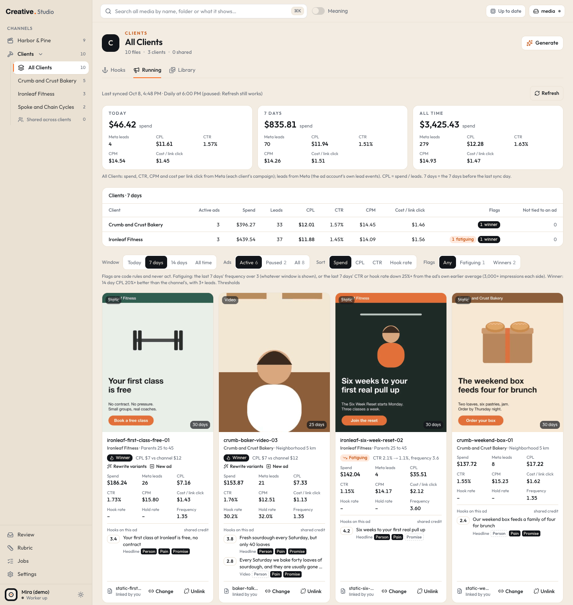
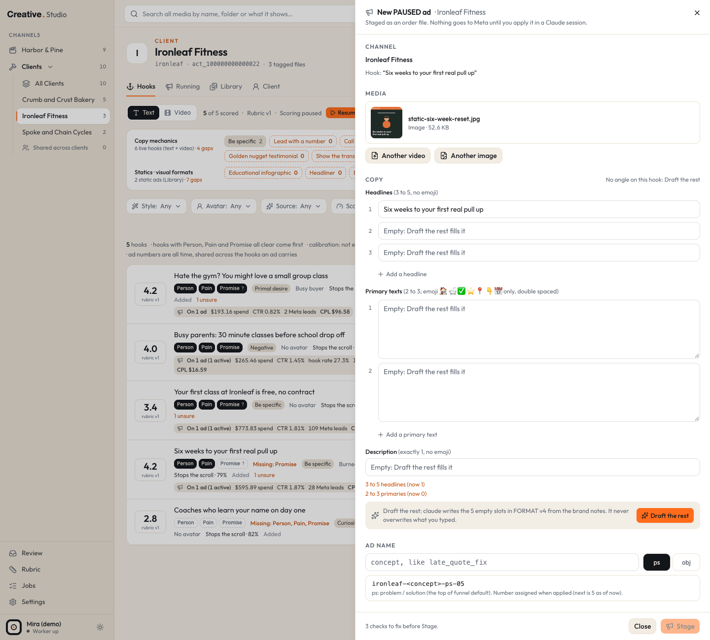

# Running

The Running tab shows the Meta ads that are running (or ran recently) for a client or for the Company lane: spend, leads, cost per lead, click and video numbers per ad, each ad matched back to its file in your Library and to the hooks it carries. It also flags ads that look tired or that beat their channel, and it lets you stage a **new PAUSED ad** for an outside apply script to create.

Everything here is read only toward Meta and GHL: Studio reads numbers, it never changes an ad, a budget or a lead.

## Where it is

| Channel | URL (demo example) |
|---|---|
| All clients of the Clients lane | `/fkbpros/all/running` |
| One client | `/fkbpros/ironleaf/running` |
| The Company lane | `/fkb/running` (the Company lane's sidebar item opens here) |

cmd+K (or Ctrl+K): **Running · All Clients**, **Running · (client)**, **Running · (Company lane)**, **Flags · Fatiguing**, **Flags · Winners**, **Refresh Meta**, **Pause Meta sync** / **Resume Meta sync**, **Ad orders**, and (type a few letters, like "new ad") **New PAUSED ad · (client)**.

The Brand lane has no Running tab: its results come from YouTube Shorts on the [Shorts](shorts.md) tab.

## Where the numbers come from

The worker reads Meta once a day at 6:00 PM New York time, every ad account one at a time, and whenever you click **Refresh**. The first read of an account fills in every day since its campaign started; later reads refresh the last few days and fill any gap left while the worker was off.

What it reads for each client is set in [Settings > Clients](settings.md#clients):

- **Campaigns**: Every campaign (the default), One campaign (by id), or From state.json (see [client files](../formats/client-files.md)).
- **Leads**: Meta leads (Meta's own count, the default), GHL leads (contacts in GHL whose source matches, by default `<code>-fb-ad`), or Meta, then GHL (Meta leads until a GHL contact carries the source).

The Company lane reads every campaign in its own ad account by default. To read one campaign instead, set `lanes.fkb.campaigns` to `{ "id": "<campaign id>" }` in your Studio config file (or `"state_json"`); there is no Settings control for it. See [configuration](../configuration.md).

Connecting Meta and GHL: [Meta](../integrations/meta.md) and [GHL](../integrations/ghl.md). Both are free API reads.

## The header

The sync line says when the account was last synced ("Last synced Oct 7, 6:02 PM"), the schedule ("Daily at 6:00 PM", or "paused: Refresh still works"), and any account error. When the last good sync was before today it adds "numbers stop there". **Refresh** asks the worker to read every account now; it starts within 15 seconds.

Three panels follow: **Today**, **7 days** and **All time**. Each shows spend, leads (Meta leads or GHL leads), CPL (spend divided by leads, a dash when there are no leads), CTR, CPM and cost per link click. The numbers come from Meta's own totals for the channel's campaigns (for the Company lane on its default, every campaign: the whole ad account). Meta's 7 days are the 7 days before the last sync day; GHL's 7 days include it.

On **All Clients**, a table follows with one row per client for the window you pick: Active ads, Spend, Leads, CPL, CTR, CPM, Cost / link click, Flags (how many active ads are fatiguing or winners) and the leads not tied to an ad. A shaded Company lane row sits at the bottom for comparison.

## Controls

| Control | Options | URL key |
|---|---|---|
| **Window** | Today, 7 days (default), 14 days, All time | `w` |
| **Ads** | Active (default), Paused, All, with counts | `status` |
| **Sort** | Spend (default), CPL, CTR, Hook rate | `sort` |
| **Flags** | Any, Fatiguing, Winners, with counts | `flag` |

A hook's ad numbers on the Hooks tab link here with `hook=<id>`: only the ads carrying that hook show, under a banner with **Show every ad**.

The cards show 15 a page, with page links below.

## Ad cards

Each card has:

- the ad's thumbnail (from Meta, cached once), its status if it is not active (Paused, Campaign paused, In review, Disapproved and so on), **Video** or **Static**, and how many days it has run;
- the ad name and its ad set (on All Clients, the client too);
- its flags, if any, with the reason (below);
- **Spend**, leads (GHL leads also show "Meta says N"), **CPL**, **CTR**, **CPM**, **Cost / link click**, **Hook rate** (videos: 3 second views divided by impressions), **Hold rate** (videos: ThruPlays divided by 3 second views), **Frequency**;
- **Hooks on this ad**: its headlines, the first sentence of each primary text and its video's hook, each with its score, linking to its row. An ad's numbers count in full for every hook it carries ("shared credit");
- the file line at the bottom.

Every ratio shows a dash when there is nothing to divide by.

### Matching ads to files

Studio matches each ad to a file in your Library, in this order:

1. the client's optional ad map file (it lists which file each ad runs; see [client files](../formats/client-files.md));
2. the media name Meta has for the ad's video or image;
3. you: **Link a file** (or **Change**) opens a picker over the channel's Library (the client's files plus shared ones). **Unlink** goes back to the automatic match.

The file line says which: "from the ad map", "by Meta's file name" or "linked by you". Click a matched card to open the file's drawer. "No local file" means no match yet. A matched file that is hidden or gone shows struck through.

## Flags

Flags are code rules. They never pause an ad, queue a job or change a score.

- **Fatiguing**: the last 7 days' frequency is above the threshold (default 3), or the last 7 days' CTR or hook rate fell by the threshold (default 25%) or more from the ad's own earlier average, with enough impressions on each side (default 3,000). The chip says why, for example "CTR 1.9% → 1.0%" or "frequency 3.6".
- **Winner**: the ad's 14 day CPL beats its own channel's 14 day CPL by the threshold (default 20%) or more, with at least the minimum leads (default 3). The chip says "CPL $12 vs channel $18".

A Winner chip adds two links: **Rewrite variants** (opens the ad's best scoring hook on its Hooks tab with the rewrite dialog ready; you still click Write) and **New ad** (the New PAUSED ad dialog with this channel, that hook and this file).

Change the thresholds in [Settings > Meta and GHL](settings.md#meta-and-ghl).

## Calibration

The Running numbers also feed **Calibration** on the Rubric page, which checks whether higher hook scores went with better CTR, hook rate and CPL. See [Hooks](hooks.md#calibration).

## New PAUSED ad

Studio can prepare a new ad for Meta, but it never sends anything to Meta. It writes **one order file** describing the ad. An outside ad apply script, run by you, reads the order, creates the ad **PAUSED** in Meta and writes the result back into the file. Studio reads that result every minute.

### Opening the dialog

- a hook row's **New PAUSED ad from this hook** button (Clients and Company lanes);
- a kept variant's **New ad** button;
- a Winner chip's **New ad**;
- a Library card's **New ad** button (in a client channel or the Company lane) or the drawer's **New PAUSED ad with this file**;
- cmd+K: **New PAUSED ad · (client)**.

The Brand lane cannot stage ads.

### The dialog, top to bottom

- **Channel**: the client or the Company lane (fixed when you came from one).
- **Media**: **Pick a video** or **Pick an image** from that channel's Library. Videos must be MP4 or MOV and at most 100 MB (over 45 MB gets a warning); images JPG or PNG up to 30 MB. The media folder must be available.
- **Copy**: 3 to 5 **Headlines** (no emoji), 2 to 3 **Primary text** fields, and exactly 1 **Description** (no emoji). The hook fills headline 1 when it fits in 40 characters, else it opens primary text 1. The rest is prefilled from the client's approved copy file for the hook's angle, or from the ad map's angle block, when you have them ([client files](../formats/client-files.md)); the line above the fields says which.
- **Live checks** under every field: your profile's dash policy, the client names and "Never say" or "Claims not allowed" lines in the brand notes, the ad map's forbidden terms, AI tell phrases, no link in a primary text, emoji only from your profile's palette, duplicates, lengths. A failing line blocks Stage; warnings (a long headline, a first line past the "See more" fold) do not.
- **Draft the rest**: the claude CLI writes only the slots that are still empty, in the same format, from the brand notes and the angle. It never overwrites what you typed. While it waits you can **Cancel**; after an error, **Retry**. The draft lands in the slots that are still empty when it finishes.
- **Ad name**: for a client, a short **concept** (letters, digits and single underscores) and **ps** (problem / solution) or **obj** (objection); the preview shows the name the ad will get. The number is assigned when the ad is applied.
- **Where it goes** (read only): for a client, the ad set whose name contains "Testing" (how many of its 4 seats are used, 3 video and 1 static; a PAUSED ad takes none, and a staged ad goes live only into an open seat, in an apply session), never "Winners"; for the Company lane, its one active ad set. Then the button (Learn More), status PAUSED, the landing page and the ad account.
- **Note for the apply session** (optional, up to 500 characters).

### Stage

The footer says how many checks still fail, or "Every check passes." Click **Stage**, read the confirm line ("Stage this ad as PAUSED. Nothing goes to Meta until you apply it in a Claude session."), then **Stage as PAUSED**. The server runs every check again before it writes anything.

When it is staged, the footer shows the order file's path and **Copy line**: a one line instruction to paste into the session where you run your apply script.

The order file goes into one of two folders from your env file: `META_PENDING_DIR` for clients, `META_FKB_PENDING_DIR` for the Company lane (see [configuration](../configuration.md)). Its format, every status and who may write it are on [ad orders](../formats/ad-orders.md).

Stage needs, for the channel: a Meta ad account, and a landing page in your business profile (`adCopy.landing`). Without them Stage says what is missing.

### After staging

Studio reads every order file back every minute and shows its status on the [Jobs](jobs.md) page (**Ad orders**), on the hook row it came from, and on the Running card:

| Status | Meaning |
|---|---|
| staged, waiting for an apply session | written; nothing has happened in Meta yet. **Cancel** on the Jobs page rewrites it as cancelled |
| being applied in a Claude session | your apply script claimed it; the step it is on shows. After 30 minutes it says it may have stopped |
| applied (PAUSED on Meta) | the ad exists in Meta, paused, with its real name |
| failed in the apply session | the script stopped; the reason and step show |
| cancelled | you cancelled it while staged |
| order file missing | the file is gone from the folder |

Once the next Meta sync has the new ad, the order shows **In Running**, and its card on the Running tab says **Staged in Studio** (it counts as paused until Meta says it is active).

## What it costs

| Action | Cost |
|---|---|
| Meta and GHL reads, flags, matching, calibration | free |
| Staging an order | free (a file on your Mac) |
| Draft the rest | one claude run on your Claude subscription ([claude CLI](../integrations/claude-cli.md)) |

## Try it in the demo

The demo has two made-up ad accounts with 30 days of made-up numbers, rebuilt for today's date every time the demo starts: Crumb and Crust Bakery (`/fkbpros/crumb/running`) and Ironleaf Fitness (`/fkbpros/ironleaf/running`), four ads each. The bike shop has no ad account.

1. Open `/fkbpros/all/running`: the client table, then switch **Window** to 14 days.
2. Set **Flags** to Fatiguing, then Winners: the demo has one ad of each.
3. Open a card whose file is linked: the drawer opens on the matching demo file.
4. On a Winner card, click **New ad** to see the New PAUSED ad dialog prefilled.

What the demo cannot do: **Refresh** has no Meta token to read with, and the daily read is paused. **Draft the rest** needs the claude CLI, which the demo switches off. **Stage** stops with "No landing page is set for this channel", because the demo profile has no `adCopy.landing`; the demo never writes an order unless you add one. The demo has no GHL, so its leads are Meta leads.
