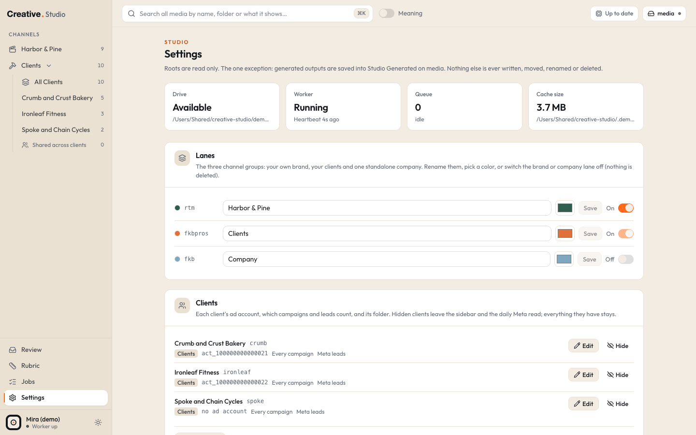

# Settings

Settings is one long page at `/settings` (the sidebar's **Settings** item, or cmd+K **Settings**). This page walks through its cards in the order they appear. Most cards act at once; nothing here needs a restart except the paths at the bottom, which come from your env file.

Many settings also exist in files: the env file, and the Studio config file that seeds your lanes and clients once. [Configuration](../configuration.md) explains those files and every key.

The line under the title states Studio's promise: your roots are read only, and the one exception is that generated files are saved into `Studio Generated` inside your media folder.

## Status tiles

Four tiles at the top:

| Tile | What it shows |
|---|---|
| **Drive** | whether your media folder (or drive) is available, and its path |
| **Worker** | Running, Scanning or Offline, with the last heartbeat |
| **Queue** | preview jobs waiting or running, the file being worked on, or the error count |
| **Cache size** | how much space Studio's cache uses, and where it is |

## Lanes

URL anchor: `/settings#lanes`.

Studio has three lanes (channel groups): the Brand lane (your own brand), the Clients lane (your clients) and the Company lane (one standalone company). Each row shows the lane's fixed internal key (what the keys are: [configuration](../configuration.md)) and lets you:

- rename it (up to 40 characters) and pick its color, then **Save**;
- switch it **On** or **Off**. The Brand lane and the Company lane can be switched off; the Clients lane is always on.

A lane that is off leaves the sidebar, the command palette, Review, coverage and the Meta read, and its pages answer 404. Nothing is deleted: switch it on again and everything is back.

The names you type here are what the whole app shows. The lane keys never change; see [configuration](../configuration.md) for what they are.

## Clients

URL anchor: `/settings#clients`.

Every client in the Clients lane, hidden ones too, with its lane, code, Meta ad account, which campaigns and leads count, and its folder.

- **Add client** and **Edit** open the same form:

  | Field | What it is |
  |---|---|
  | **Code** | 2 to 32 lowercase letters or digits, set once and never changed (it is in URLs, file names and ad names) |
  | **Name** | "Short / longer" shows the part before the slash in the sidebar |
  | **Meta ad account** | `act_` followed by digits; empty means no Meta numbers. Once the account has synced numbers it cannot change: add the new account as a new client with a new code (and hide the old one) |
  | **Who they are** | one line for the AI: brand, place, services (the same line as the Client tab's Jev hint) |
  | **Folder** | optional: the client's folder inside your client docs folder, holding the approved copy file and `Static Ads`. Empty turns Import approved copy off |
  | **Campaigns** | Every campaign, One campaign (then its **Campaign id**), or From state.json |
  | **Leads** | Meta leads, GHL leads, or Meta, then GHL; with GHL a **GHL source** (empty means `<code>-fb-ad`) |
  | **Sort** | sidebar order, lower first |

- **Hide** / **Unhide**: a hidden client leaves the sidebar, its pages, the command palette, Review, coverage, the New ad channel list and the daily Meta read. Its files, hooks, orders and numbers all stay.

Clients are never deleted. Clients listed in your Studio config file are added once on the first start; after that this card owns them. What the campaign and lead options read is on [Running](running.md) and [client files](../formats/client-files.md).

## Roots

URL anchor: `/settings#roots`.

The folders the worker indexes, each with its lane, its file count, how many files are missing and how many are hidden by ignore patterns. The switch on each row turns a root off (its files leave every list) or on. Changes apply within about 5 seconds.

To add one: paste an absolute folder path, pick its lane, **Add root**. Studio refuses your whole disk, your home folder, a folder inside or around Studio's own data, a folder that does not exist, and a folder that overlaps an existing root.

A note under the form, about Company lane folders (it is highlighted when you pick the Company lane for the new root): a Google Drive folder must be marked Available offline (or copied to your media folder) before you add it, or indexing makes every file download.

More on what a root does: [Library](library.md#roots).

## Generation engines

What Generate can use right now:

- **Higgsfield**: images and video on Higgsfield credits. Rows: installed, signed in; the balance and plan when it is ready.
- **ChatGPT (Codex)**: images included in a ChatGPT plan. Rows: installed, signed in with ChatGPT.

Each box says **Available** or **Unavailable** with the reason. Setup: [Higgsfield](../integrations/higgsfield.md), [Codex](../integrations/codex.md). Using them: [Generate](generate.md).

## AI

The AI card has three parts.

### Describe

- **Ollama**: the vision model and the address it uses, with **Reachable** and **Model pulled** checks. When something is missing it says what to run.
- **whisper.cpp**: **Binary found** and **Model found**, with the paths it looked for.
- **Described N / M images and videos**, a progress bar, spoken openings checked, how many have speech, errors and Describe again requests. A state line says what Describe is doing.
- **Pause** / **Resume describing**, **Retry N errors**, **Check again**.

Describe is free and local. Details: [Describe](describe-classify-review.md#describe), [Ollama](../integrations/ollama.md), [whisper.cpp](../integrations/whisper.md).

### Classify (Jev)

- **Jev (TypeSafe)**: the pinned model, **Key present**, and whether Jev's model list answers (a free check). With no key it tells you which env file to paste `TYPESAFE_API_KEY` into.
- **Spend**: today against the daily cap, all time, calls today and all time. The day resets at midnight New York time.
- **Classified N / M described**, with Needs review, errors, Classify again requests and the questions' version.
- **Pause classify** / **Resume classifying**, **Retry N errors**.
- **Confidence threshold** (0.30 to 0.95, default 0.70) with **Save**: answers under it are unsure. It applies to the next files Jev classifies; it also updates the unsure marks on existing hook scores at once (no Jev call).
- **Daily cap (USD)** (0 to 20, default 1) with **Save**: the most Jev may cost in one day, across classify, hook scoring and search by meaning. When it is reached, Jev work waits until the next day.

Details: [Classify](describe-classify-review.md#classify), [TypeSafe Jev](../integrations/typesafe-jev.md).

### Hooks (Jev scoring)

- **Scored N / M live hooks** on the current rubric version, with queued, Score again requests, errors and the state.
- **Pause hook scoring** / **Resume hook scoring**, **Retry N errors**.
- **Shorts board gate (main hook overall)** (1 to 5, default 2.6) with **Save**: undecided Idea cards whose main hook scores under it sit behind Show weaker on the [Shorts](shorts.md#the-hook-gate) board. URL anchor: `/settings#shorts-gate`.
- **Jev spend by purpose**: today, calls today, all time and calls, one row per purpose that has calls: Classify, Search by meaning, Hook scoring, Copy gate, Page scoring and Tests (calls logged by test runs, if any).

## Claude

URL anchor: `/settings#claude`.

The claude CLI writes hook variants, Shorts moments and ad copy drafts on your own Claude subscription (never an API key).

- **claude CLI found** and **Signed in (Claude subscription)**. The login lives in the macOS keychain; Studio never sees it.
- A state line: Signed in (with the sign-in method when the CLI reports one, for example "Signed in (claude.ai)"), Signed out (claude jobs fail until you sign in), Waiting for the sign-in in Terminal…, or claude CLI not found.
- **Sign in** (or **Sign in again**) opens a Terminal window that runs `claude auth login`; finish it in your browser and the card updates by itself. **Check again** checks now.

Jobs that failed while you were signed out need a **Retry** on the [Jobs](jobs.md) page. Setup: [claude CLI](../integrations/claude-cli.md).

## Meta and GHL

URL anchor: `/settings#meta`.

The Running tab's numbers, read once a day, read only.

- Presence lines (yes or no, never the values): the clients' Meta token, the Company lane's own Meta token, the GHL key and location, and how the Company lane's leads are counted. Each names the env file it reads.
- The sync state, the last run and the next daily run, **Pause** / **Resume** and **Sync now** (reads every account now, even while paused).
- One row per ad account: channel, ad account, last good sync, leads source (Meta or GHL), ads and active ads, and any Meta or GHL error.
- A note: Studio never writes to Meta or GHL; the worker reads every account at 6:00 PM New York time and on Refresh; tokens and keys are read by the worker only and never shown, logged or stored.

Then the thresholds form:

**Running flags** (see [Running](running.md#flags)):

| Field | Default |
|---|---|
| Fatiguing: frequency above | 3 |
| Fatiguing: CTR or hook rate down | 25% |
| … with impressions on each side | 3,000 |
| Winner: 14 day CPL better by | 20% |
| … with at least (leads) | 3 |

The fatiguing frequency is always the last 7 days' frequency, whatever window the Running tab shows.

**Calibration minimums** (see [Hooks](hooks.md#calibration)):

| Field | Default |
|---|---|
| A hook counts for CTR / hook rate with (impressions) | 1,000 |
| A hook counts for CPL with (leads) | 3 |
| (Brand lane): a hook counts with (views) | 300 |
| A cell needs at least (hooks) | 8 |
| … on at least (ad groups) | 8 |

**Save** stores them; **Reset** goes back to the defaults. They are code rules and free: flags and the report never pause an ad, queue a job or change a score.

Setup: [Meta](../integrations/meta.md), [GHL](../integrations/ghl.md).

## YouTube

URL anchor: `/settings#youtube`.

Your Brand lane's YouTube Shorts results, read once a day with Studio's own read only access.

- **Google OAuth client (Desktop)**: whether the client file is there (read only).
- **Connected (read only)**: whether Studio holds its own token, in a private file.
- The channel, the last sync, the next daily run, how many Shorts and how many are linked to a file.
- **Connect YouTube** (or **Reconnect**) opens Google's consent page in a new tab. After you allow both read only permissions, Google sends you back to Studio's address on your Mac and the card shows the result.
- **Sync now**, **Pause** / **Resume**, and **Disconnect** (asks first; Studio's token is revoked and deleted, synced numbers stay).

Setup and what each message means: [YouTube](../integrations/youtube.md). The list itself is on [Shorts](shorts.md#the-youtube-shorts-list).

## Ignore patterns

Names the worker skips: `dir/` skips a folder anywhere, `.*` skips dotfiles, a glob like `*.tmp` matches a file name. Type one and **Add**; the small x removes it. Matching files are hidden, never deleted, so removing a pattern brings them back with their tags. See [Library](library.md#ignore-patterns) for the patterns a fresh Studio starts with.

## API keys

Presence only: whether `TYPESAFE_API_KEY` (Jev), the Meta tokens (`META_ACCESS_TOKEN` in each Meta env file) and `GHL_API_KEY` are set, and which file each one lives in. Values are never shown or sent to the browser. You set them by editing the files; see [configuration](../configuration.md) and the [integrations](../integrations/typesafe-jev.md) pages.

## Tag rules

URL anchor: `/settings#tag-rules`.

Folder globs that tag Clients lane files to clients. Each row shows the glob and its clients: remove a client with its x, add one with **+ Client**, delete the rule with the trash button. To add a rule: type a glob, pick one or more clients, **Add rule**.

Globs are relative to the root (an absolute path also works). Only `*`, `**` and `?` are wildcards; parentheses and other characters in folder names are matched as written. A file with no client is Shared. Rules never overwrite a tag you set by hand, and a folder tag always wins over a Jev tag. Rules apply on the next scan of each file, and to every file when the worker starts. Adding a client also adds a rule for its own folder under `Studio Generated`; when the client's folder holds a `Static Ads` folder, that folder becomes a root with a rule for the client.

## Paths

Read only: the database, the cache, the logs folder, the env file Studio read at start, and the address the app listens on (`http://127.0.0.1:4747` by default). These come from your env file; change them there and restart the app and the worker. See [configuration](../configuration.md).

## Try it in the demo

Open `/settings` in the demo:

- **Lanes**: Harbor & Pine (Brand lane), Clients, and Company switched **Off**. Rename a lane and watch the sidebar change.
- **Clients**: the three made-up clients; the bike shop has no ad account. Open **Edit** on the bakery to see that its ad account is locked (it has synced demo numbers).
- **Roots**: the demo's two folders inside `demo/media`, plus the three `Studio Generated` lane folders every Studio starts with (they stay empty until something is generated).
- **Generation engines**: both unavailable (the demo switches engines off).
- **AI**: Ollama not reachable and whisper not found (the demo points both at nothing), no Jev key, and every queue paused.
- **Claude**: the claude CLI is not found (switched off in the demo).
- **Meta and GHL**: no tokens, the daily read paused, and the two demo ad accounts with their made-up numbers.
- **YouTube**: not connected.
- **Tag rules**: one rule per client folder in `demo/media`, plus one per client for its `Studio Generated` folder.

Changes you make in the demo stay in its throwaway data folder; `npm run demo -- --reset` starts it fresh.
