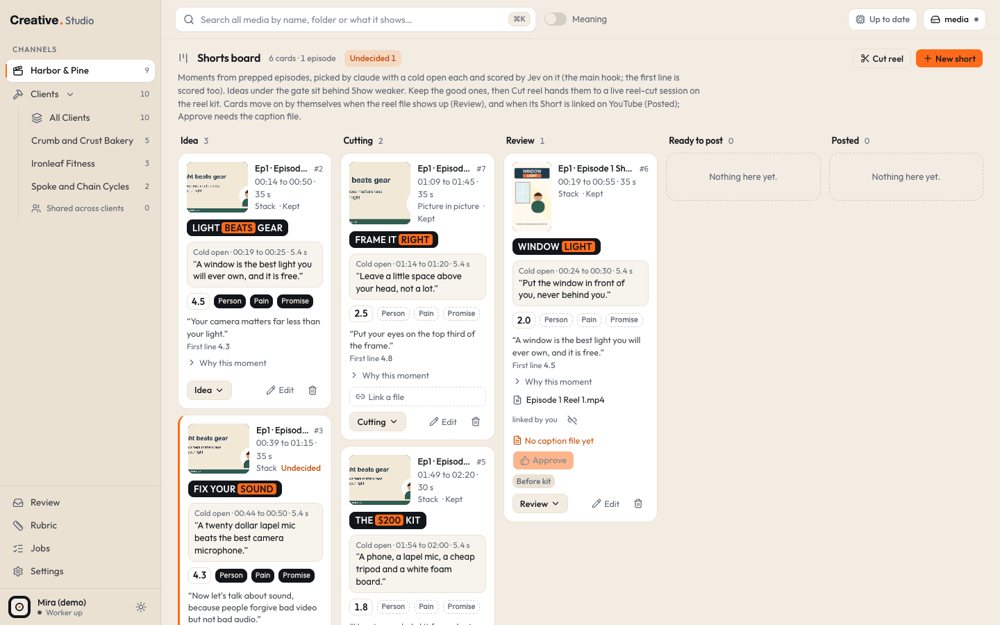
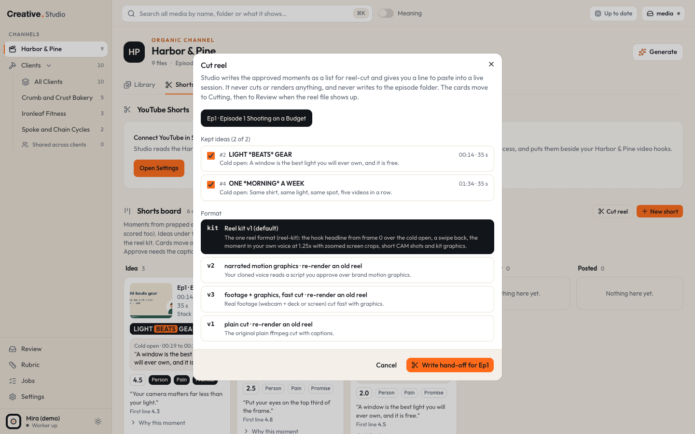

# Shorts

The Brand lane's **Shorts** tab is where long episodes turn into short vertical reels. It has two parts:

- the **YouTube Shorts** list at the top: every Short on your connected YouTube channel with its numbers, matched to your files and their hooks;
- the **Shorts board** below it: moments picked from your episodes, moving through five columns from **Idea** to **Posted**.

Studio picks and scores moments, keeps the board and writes a hand-off list. It never cuts, renders or uploads a video: an outside reel cutting tool you run does that.

## Where it is

`/rtm/shorts` (the Brand lane's Shorts tab). The board is at `/rtm/shorts#board`, the YouTube list at `/rtm/shorts#shorts`.

cmd+K (or Ctrl+K): **Shorts board**, **Shorts · (Brand lane)**, **New short from Ep1** (one entry per episode), **Cut reel · Ep1** (episodes with kept ideas), **Sync YouTube**, **Connect YouTube**.

## Episodes

An episode is a long video in the Brand lane with a transcript next to it. Studio lists an episode when it finds:

1. a video in a Brand lane root whose category is **Episode** (set by [Classify](describe-classify-review.md), or by you in the drawer), and
2. in the same folder, a transcript file named with your profile's episode prefix and a number: `<prefix>N.srt`. With the default prefix (`Episode `) that is `Episode 1.srt`, `Episode 2.srt` and so on.

The number in the transcript's name is the episode number; the folder's name is its title ("Ep1 · Episode 1 Shooting on a Budget"). When a folder holds several episode videos, the longest one is the master. A folder with an episode video but no transcript is listed in the New short dialog as "Not prepped yet". The transcript is read, never changed. The prefix is set in your business profile (`episodes.prefix`, see [configuration](../configuration.md)).

### Word timed transcripts

For each episode the worker also makes a word timed transcript: whisper.cpp listens to the episode's cached 480p proxy (never the original) and Studio lines the transcript's words up with whisper's timings. Moments then start and end on whole sentences. It takes a minute or two per episode, one episode at a time, and needs [whisper.cpp](../integrations/whisper.md). The New short dialog shows its state under each episode ("N sentences (word-timed transcript)", "Transcribing…", "Transcript failed: ...").

## New short

**New short** (or cmd+K **New short from Ep N**) opens a list of your episodes. Pick one and click **Write moments for EpN**.

1. The claude CLI, on your Claude subscription, reads the episode's sentences and proposes 5 to 8 moments, each 30 to 60 seconds (never over 90), each with a cold open, a few caps **hook words**, a reason ("Why this moment") and a layout.
2. Studio checks every moment in code: inside the episode, starts and ends on a sentence, 30 to 90 seconds after snapping, no profanity in the first 3 seconds, hook words 2 to 6 words, no dash used as punctuation or AI tell phrase, not mostly overlapping another card. A moment that fails is dropped; a bad cold open is dropped on its own and the card keeps going. If fewer than 3 survive, claude gets one more try.
3. The survivors land in **Idea**, and Jev scores their hooks.

A job waits while its episode's word timed transcript is being made ("waiting for the word-timed transcript"). Without whisper.cpp it keeps waiting. Jobs and their logs are on the [Jobs](jobs.md) page under **Short moments**; the board shows a strip for a job that is running, waiting or failed, with **Cancel** or **Retry**.

Cost: one claude run on your subscription and Jev scoring of about $0.002. A run takes from about a minute to several minutes (real runs took 75 seconds to more than 5); it is stopped after 15 minutes. See [claude CLI](../integrations/claude-cli.md).

## The board

Five columns: **Idea**, **Cutting**, **Review**, **Ready to post**, **Posted**. On a wide window they sit side by side (the row scrolls sideways inside itself when the window is narrow); on a phone or a narrow window, buttons above the board switch between columns. The header counts cards and episodes and shows **Undecided N** while new ideas wait for you.

### A card

- The episode and the card's number (`#3`), the time range and length, the layout, and **Undecided** or **Kept**.
- The poster: the episode's poster, or the reel's own 9:16 poster once a reel is linked (hover to play it).
- **Hook words**: 2 to 6 caps words, the reel's opening headline. The part between one pair of `*` shows in the orange block, for example `LIGHT *BEATS* GEAR`.
- **Cold open**: one or two sentences from inside the moment, 2 to 6 seconds, that the reel plays first. "No cold open yet" in orange means you need to pick one (Cut reel needs it).
- The score of the card's **main hook** (the cold open's line, else the first line) with its Three P's pills; it links to the hook on the Brand lane Hooks tab. The first line's own score shows small under it.
- The first line in quotes, and **Why this moment** (click to open).
- The reel block (below), then the buttons.

### Buttons

| Control | What it does |
|---|---|
| **Keep** | marks an undecided idea as kept |
| **Discard** | removes the card (its own hooks are archived when no other card uses them) |
| the status button | **Move to** any column, either way. **Make explainer** (in the same menu) turns the main hook into an explainer idea |
| **Edit** | opens the edit panel (below) |

### Edit panel

- **Start** and **End** arrows move the moment one sentence earlier or later (one transcript cue when the episode has no word timed transcript yet), keeping it 30 to 90 seconds. A new start gives a new first line, which Jev scores again.
- **Cold open picker**: the moment's sentences with their lengths. Click one, or two next to each other, then **Set cold open** (or **Swap cold open**). It must come to 2 to 6 seconds; the server checks it again and Jev scores it as the card's main hook.
- **Hook words**: type 2 to 6 words, mark the orange part with one `*...*` pair, **Save**.
- **Layout**: Stack, Center, Blur fill or Picture in picture (the layout the reel cutting tool should use).

### The hook gate

Undecided Idea cards whose main hook scores under the gate sit behind **Show weaker (N) · under 2.6** at the bottom of the Idea column. The default gate is 2.6; change it in [Settings > AI](settings.md#ai) (**Shorts board gate**, 1 to 5). Cards that are not scored yet and kept cards always show.

### Explainer ideas

An explainer idea is a card with no episode moment: an idea for a narrated reel made by an outside explainer tool.

- **Send to Shorts** on a Brand lane hook row ([Hooks](hooks.md)) makes one from that hook.
- **Make explainer** in a card's status menu makes one from the card's main hook (it remembers the episode and time).

An explainer card shows **Copy paste line**: a one line instruction for your explainer tool. Nothing is written to disk. It reaches Review only when you link its finished file.

## Cut reel

**Cut reel** (or cmd+K **Cut reel · Ep N**) hands kept ideas to your reel cutting tool.

1. Pick the episode (only episodes with kept ideas show).
2. Tick the kept ideas to send. A card without a cold open cannot go ("Pick a cold open first").
3. Pick the **Format**: the reel kit format (the default, labelled with your profile's kit name and the kit's version), or one of three older formats for re-rendering an old reel (narrated motion graphics, footage + graphics fast cut, plain cut).
4. **Write hand-off for EpN**.

Studio writes one JSON list into its hand-off folder (`STUDIO_HANDOFFS`, by default `handoffs` in Studio's data folder), named `<prefix>N reels.json` (or with a date added, so an existing list is never overwritten). It moves the ticked cards to **Cutting** and shows the line to paste into the session where you run your reel cutting tool, with **Copy line**. A card in Cutting keeps that line (**Copy paste line**).

Studio never cuts or renders the reel and never writes into the episode folder; the tool copies the list there itself. The list's fields, the kit fields and the file names are on [the Cut reel hand-off](../formats/cut-reel-handoff.md).

## Automatic moves

The worker checks the board every 15 seconds:

- **Cutting → Review** when a reel file for the card shows up in the episode's folder or a sibling folder that holds the episode's reels list: `<prefix>N Reel K.mp4`, `<prefix>N Reel K vV.mp4` (the highest version wins) or `reels/reelK/out/reelK.mp4`, written after the card entered Cutting. The file must be inside one of your roots so it is indexed.
- In **Review**, the card also finds its caption, `<prefix>N Reel K caption.md`, and shows a preview ("No caption file yet" until then). **Approve** needs both the reel and the caption, and moves the card to **Ready to post**.
- **Ready to post → Posted** when a YouTube Short is matched to the card's reel file (see the YouTube list below). The card then shows the Short's title, views and "% viewed" next to the channel median.

You can always link a reel by hand: **Link a file** (or the link button next to the file name) picks a Brand lane video and moves an Idea or Cutting card to Review. **Unlink** goes back to the automatic match. A card still in Cutting ten minutes after its hand-off shows **Reel already made? Link a file**: a reel made before the card entered Cutting never moves it by itself.

Moving a card back by hand holds it: the same reel or Short will not move it forward again on its own.

## Kit notes and "% viewed"

A reel cut with your reel kit can leave a small note next to the reel file: `<reel name without " vN"> kit.json`, saying which kit version it used and whether it tested a change. Studio reads these notes (never writes them) every minute, and tags each Short:

- **Kit vN**, **Kit vN · test: (change)**, or **Before kit** when there is no note.
- "**31% viewed · channel 24% (12)**": the Short's average percentage viewed next to the channel's median over the Shorts that have numbers.
- A test reel that has been up 7 days or more, with 300 or more views, and beats the median of the same kit version's other reels (at least 2 of them) by 5 points or more shows "Beat kit vN by X points: fold in?".

Studio also reads one small `VERSION` file from your reel kit folder (`STUDIO_REEL_KIT_DIR`) to label the kit format; nothing else there is opened. The note's format: [kit notes](../formats/kit-notes.md).

## The YouTube Shorts list

At the top of the tab. It needs [YouTube](../integrations/youtube.md) connected in Settings; until then it shows **Connect YouTube in Settings**.

- The header: the channel, how many Shorts, how many are linked to a file, the last sync and **Sync now**.
- **Sort**: Newest, Views, Avg % viewed. **Kit** filter: Before kit, Kit vN (each with its median). The `hook` key (from a hook row's Short numbers) shows only that hook's Shorts.
- Each row: the thumbnail, title, Views, Avg % viewed, Avg view, Likes, Subs gained, Engaged views, the Kit tag, the linked file (**Change**, **Unlink**, or **Link a file**) and that file's video hook with its score.

Studio reads your channel once a day at 6:00 AM New York time (and on **Sync now**), read only. A video counts as a Short when it is 3 minutes or shorter. Shorts are matched to your Brand lane files by title and length; link the rest by hand. If Google stops accepting Studio's access, the list says so and links to **Reconnect in Settings**.

## What it costs

| Action | Cost |
|---|---|
| Episodes, word timed transcripts, the board, automatic moves, kit notes, the hand-off file | free, on your Mac |
| New short | one claude run on your Claude subscription, plus Jev scoring of the moments' hooks (about $0.002) |
| Setting a cold open, nudging a start | one Jev call for the new line, a fraction of a cent |
| YouTube reads | free API reads |

## Try it in the demo

The demo has one episode, `Episode 1.mp4` with its `Episode 1.srt`, and six cards from it: undecided and kept ideas in **Idea**, two cards in **Cutting**, and one in **Review** with the demo reel linked. Every card has hook words and a cold open, and their hooks carry demo scores.

1. Open `/rtm/shorts#board` and open **Edit** on an Idea card: try the **Start** and **End** arrows and the cold open picker.
2. Click **Keep** on an undecided card, then **Cut reel**: tick it, pick the kit format and **Write hand-off for Ep1**. The demo writes the list into its own `.demo-data/handoffs` folder and moves the card to Cutting.
3. The Review card shows its linked reel and "No caption file yet", so **Approve** stays off.

What the demo cannot do: **New short** needs the claude CLI (switched off in the demo) and whisper (not set up), so a job would only wait. The YouTube list shows **Connect YouTube in Settings**, and no card can reach Posted. The demo has no kit notes. Undecided cards scored under the gate, if any, sit behind **Show weaker**.
