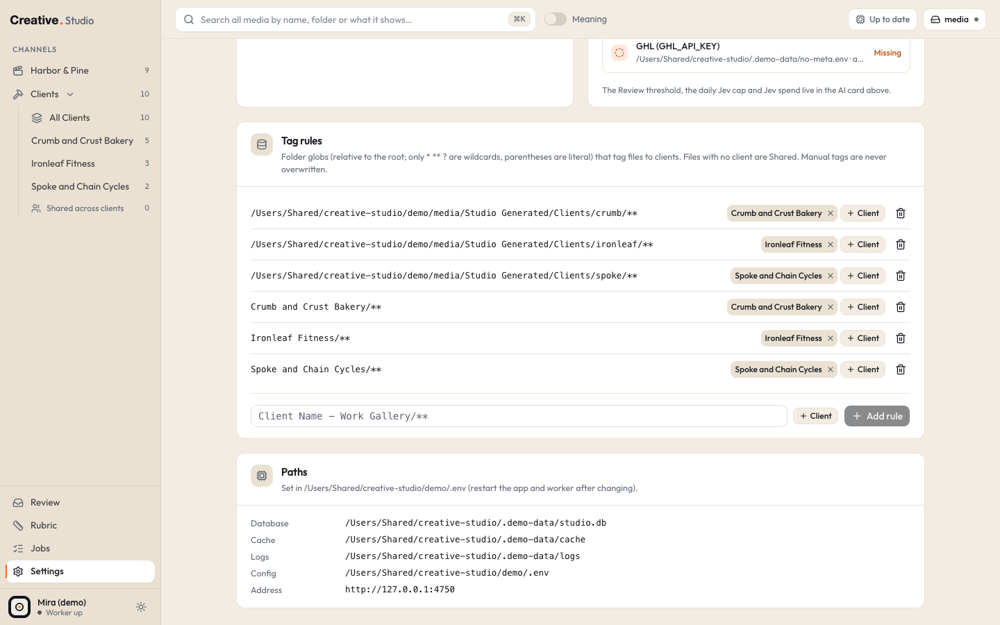

# Install Creative Studio

This guide takes you from a fresh Mac to a running Studio that starts by itself when you log in. You paste commands into
Terminal (Applications > Utilities > Terminal). Run every command from the Studio folder unless a step says otherwise.

Want to look around first? The [README](../README.md) shows how to run the demo, which needs none of the steps below
except Homebrew, Node, ffmpeg and `npm install`.

## What you need

- A Mac with Apple Silicon (M1 or newer) and at least 16 GB of memory. Intel Macs are not supported.
- About 2 GB of free disk for the app, plus room for the cache (thumbnails and 480p previews of your media).
- An internet connection for the install. After that, Studio itself only goes online for the services you connect.

## 1. Homebrew

Homebrew installs the command line tools Studio uses. Check whether you already have it:

```bash
brew --version
```

If you see `Homebrew 4...` (or any version), skip to step 2. If you see `command not found`, install it:

```bash
/bin/bash -c "$(curl -fsSL https://raw.githubusercontent.com/Homebrew/install/HEAD/install.sh)"
```

At the end the installer prints "Next steps" with two or three commands that add Homebrew to your PATH. Run them, close
Terminal and open it again, then check `brew --version` once more.

## 2. Node.js 22

Studio needs Node.js 22 or newer. Check what you have:

```bash
node -v
```

If you see `v22` or higher (for example `v22.12.0`), skip to step 3. Otherwise install Node 22:

```bash
brew install node@22
```

Homebrew keeps this version out of your PATH until you add it. Add it, then open a new Terminal window:

```bash
echo 'export PATH="/opt/homebrew/opt/node@22/bin:$PATH"' >> ~/.zprofile
```

In the new window, `node -v` should print `v22...`.

## 3. ffmpeg

The worker uses ffmpeg and ffprobe to make posters, contact sheets and previews. Studio looks for them at
`/opt/homebrew/bin`, which is where Homebrew puts them on Apple Silicon.

```bash
brew install ffmpeg
```

Check it:

```bash
/opt/homebrew/bin/ffprobe -version
```

You should see `ffprobe version ...`. Installed this way, Studio finds both programs with no setting at all, including
when it runs in the background (step 11).

If you installed ffmpeg some other way, tell Studio where both programs are: set `FFMPEG_PATH` and `FFPROBE_PATH` to
their full paths in your settings file (step 6). Studio reads them every time it starts, also in the background.

## 4. Get the code

You need git. Check it:

```bash
git --version
```

If macOS asks to install the "command line developer tools", click Install, wait for it to finish, and run the check
again. Then choose where the Studio folder should live (your home folder is fine) and clone it:

```bash
git clone https://github.com/ronnytiburcio/creative-studio.git
```

```bash
cd creative-studio
```

From here on, every command runs inside this `creative-studio` folder.

## 5. Install the packages

```bash
npm install
```

This takes a minute or two. Two packages ship native parts for your Mac: `better-sqlite3` (the database) and `sharp`
(image thumbnails). npm downloads ready made versions of both.

If `npm install` fails with an error that mentions `better-sqlite3`, `sharp`, `node-gyp` or `prebuild-install`:

1. Make sure `node -v` prints `v22` or higher (step 2).
2. Install Apple's command line tools, which npm needs to build these packages itself:

   ```bash
   xcode-select --install
   ```

3. Remove the half installed packages and try again:

   ```bash
   rm -rf node_modules
   ```

   ```bash
   npm install
   ```

More fixes are in [Troubleshooting](troubleshooting.md).

## 6. Your settings file and media location

Do this before the first start: the first start records where your `Studio Generated` folders live, inside your media
location.

Studio reads your media where it already is and never changes, moves or deletes those files. Your **media location**
(`STUDIO_DRIVE`, default `~/Studio-Media`) is the drive or folder that holds it. Studio writes in exactly one place
inside it: a `Studio Generated` folder for the images and videos you make with Generate. Pick one of these:

- **A folder on this Mac** (`folder` mode, the default): any readable folder counts as available.
- **An external drive** (`external` mode): Studio checks that the drive is really plugged in, shows a banner when it is
  not, and keeps working from the cache until it is back.

Create the settings folder:

```bash
mkdir -p ~/.studio
```

Make it private to you, since it will hold your keys:

```bash
chmod 700 ~/.studio
```

Copy the settings template into it. `.env.example` is the same file Studio would write on its first start:

```bash
cp .env.example ~/.studio/.env
```

Make the file readable by you only too:

```bash
chmod 600 ~/.studio/.env
```

Open it in nano, a simple Terminal editor:

```bash
nano ~/.studio/.env
```

Move to the end of the file with the arrow keys and add your own lines. For an external drive named "Media Drive":

```text
STUDIO_DRIVE=/Volumes/Media Drive
STUDIO_DRIVE_MODE=external
```

For a folder on this Mac, for example `~/Movies/Studio Media`:

```text
STUDIO_DRIVE=~/Movies/Studio Media
STUDIO_DRIVE_MODE=folder
```

Write the path as it is, with no quotes, even when it has spaces. `~/` at the start means your home folder.

Save with Ctrl+O then Enter, and leave nano with Ctrl+X.

The media location must exist before Studio starts: Studio never creates it, and shows it as not available until it
is there. An external drive exists once it is plugged in. For a folder on this Mac, create it now (here the example
folder; use your own path, in quotes because of the space):

```bash
mkdir -p "$HOME/Movies/Studio Media"
```

If you keep the default (no `STUDIO_DRIVE` line), create `~/Studio-Media` instead:

```bash
mkdir -p ~/Studio-Media
```

Studio listens on port 4747. If another program already uses it, add a line with a free port, for example:

```text
STUDIO_PORT=4760
```

The background services (step 11) and the desktop app (step 12) use the same port, so you never set it anywhere else.

Write new lines like these rather than removing the `#` from the template's lines: several template lines end with a
note in parentheses, and that note would become part of the value. Every setting is described in
[Configuration](configuration.md).

Changing `STUDIO_DRIVE` after the first start works for browsing, but the `Studio Generated` folders that Studio indexed
stay at the old location. Add the new ones in Settings > Roots once Generate has made them.

## 7. Your lanes and clients (optional)

Studio groups channels into three lanes: **the Brand lane** (your own content), **the Clients lane** (one channel per
client) and **the Company lane** (one standalone company). You can rename them, set their colors, switch the Brand
lane or the Company lane off and add clients in Settings > Lanes and Settings > Clients at any time, so this step is
optional.

If you prefer to describe them in a file, create `~/.studio/studio.config.json` before the first start. In the file,
`rtm`, `fkbpros` and `fkb` are the fixed internal keys of the Brand lane, the Clients lane and the Company lane. They
mean nothing you need to know, and the app always shows your own lane names (see [Configuration](configuration.md)).
A small example with made-up names:

```json
{
  "lanes": {
    "rtm": { "name": "Harbor & Pine" },
    "fkb": { "enabled": false }
  },
  "clients": [
    { "code": "crumb", "name": "Crumb and Crust Bakery", "metaAdAccount": "act_100000000000021" },
    { "code": "spoke", "name": "Spoke and Chain Cycles" }
  ],
  "roots": [{ "path": "Brand Videos", "lane": "rtm" }]
}
```

This names the Brand lane "Harbor & Pine", switches the Company lane off, adds two clients and indexes the folder
`Brand Videos` in the Brand lane. A root path that does not start with `/` is read inside your media location, so with
the drive from step 6 it means `/Volumes/Media Drive/Brand Videos`.

Two things to know about this example. A client with a `metaAdAccount` makes the worker try a Meta sync, so until you set up the Meta token ([Meta](integrations/meta.md)) the Jobs page shows one Meta error per such client; leave `metaAdAccount` out until then. And `name` renames the lane in the sidebar and Settings, while the big header above each lane's tabs comes from the business profile (`profile.lanes.rtm.fullName`, see [Configuration](configuration.md)); set both if you want the header to match.

To write it, open nano, paste your version, then save and exit as before:

```bash
nano ~/.studio/studio.config.json
```

Good to know:

- The file **seeds** lanes and clients once: a lane or client is added when it is missing and never changed after that.
  From then on Settings owns them. Edit names in Settings, not in the file.
- The three lanes are created on the very first start. Lane names, colors and on or off settings you add to the file
  later do not apply; set them in Settings > Lanes. Clients, roots and folder rules you add later are picked up at the
  next start.
- Unknown keys are refused. A typo stops the start with a message that names the field, for example
  `clients.0.code: 2 to 32 lowercase letters or digits`.
- `studio.config.example.json` in the Studio folder shows every key, including the business profile that sets the
  wording the AI tools read. Its names and accounts are made up: copy only the parts you need.
- Keep the file somewhere else? Set `STUDIO_CONFIG` in `~/.studio/.env` to its full path.

The whole format is in [Configuration](configuration.md).

## 8. First start

Studio is two programs: the **web app** (the pages you click) and the **worker** (it scans your folders, makes
previews and runs every queue). They run separately, so open two Terminal tabs (Cmd+T), both in the Studio folder.

In the first tab, start the web app:

```bash
npm run dev
```

You should see:

```text
Creative Studio (dev) on http://127.0.0.1:4747
```

If you set `STUDIO_PORT` in step 6, you see your port instead of 4747, here and in every address below.

If this fails, see [Troubleshooting](troubleshooting.md).

If you skipped step 6, a line `config: created template /Users/you/.studio/.env` comes first: Studio wrote the
template for you and uses `~/Studio-Media` as your media location. To pick another one now, stop both programs, do
step 6 (skip the copy, the file exists), and start over with an empty data folder. Only do this right after the first
start, while the data folder holds nothing of yours. Look first:

```bash
ls ~/Studio-Data
```

You should see only Studio's own entries, such as `studio.db` (with `studio.db-wal` and `studio.db-shm`), `cache` and
`logs`. If you see anything else, stop and check before you go on. Then delete the folder. This removes Studio's
database, cache and logs only; it never touches your media:

```bash
rm -rf ~/Studio-Data
```

Then run `npm run dev` again.

In the second tab, start the worker:

```bash
npm run worker
```

You should see a line like `worker: db=/Users/you/Studio-Data/studio.db cache=/Users/you/Studio-Data/cache`. Now open
[http://127.0.0.1:4747](http://127.0.0.1:4747) in your browser.

What happened on the first start:

- `~/Studio-Data/` was created for the database (`studio.db`), the cache and the logs.
- The database got your lanes and clients, a starter rubric, draft notes and the `Studio Generated` folders as roots.
- Studio only listens on `127.0.0.1` (this Mac). Nobody else on your network can open it.

If either command stops with `Creative Studio config is invalid`, the message names the setting and the rule it broke.
Fix that line in `~/.studio/.env` (or in your config file) and start again.

To stop either program, click its Terminal tab and press Ctrl+C. After you change a setting, stop both and start them
again.



## 9. Add your media folders

Studio indexes only the folders you add as **roots**. A fresh install has just the `Studio Generated` folders (one per
lane), so the Library is empty until you add yours.

Open Settings > Roots, enter the full path of a folder (for example `/Volumes/Media Drive/Brand Videos`), pick its lane
and add it. The worker starts scanning within a few seconds and makes thumbnails and previews in the background; the
Jobs page shows how far it is.

To get a folder's full path: in Finder, right-click the folder, hold the Option key and choose **Copy "Folder Name" as
Pathname** (the menu shows your folder's name), then paste it. You can also drag the folder from Finder into a Terminal
window, which types its path; Terminal puts a backslash before each space (`Media\ Drive`), so remove those before you
paste the path into Settings.

- Add the folders that hold your media, not the whole media location: roots cannot overlap, and the `Studio Generated`
  folders inside it are roots already.
- Your home folder and the whole disk cannot be roots.
- To tag files to clients by folder, add folder rules in Settings > Tag rules (see
  [Configuration](configuration.md#folder-tag-rules-and-ignore-patterns)).

## 10. Optional services

Every service is optional. Add the ones you want, one at a time:

| Service | What it adds | Guide |
|---|---|---|
| Ollama + `qwen3-vl:8b-instruct` | Describe: what each file shows (free, local) | [Ollama](integrations/ollama.md) |
| whisper.cpp + `ggml-small.en.bin` | What each video says, word timing for Shorts (free, local) | [whisper](integrations/whisper.md) |
| Jev (TypeSafe) key | Classify, Review, hook scores, search by meaning (paid per call) | [Jev](integrations/typesafe-jev.md) |
| Meta token | The Running tab | [Meta](integrations/meta.md) |
| GHL key | Leads per ad | [GHL](integrations/ghl.md) |
| YouTube | Your Shorts and their numbers | [YouTube](integrations/youtube.md) |
| Higgsfield CLI | Generate images and videos (credits) | [Higgsfield](integrations/higgsfield.md) |
| Codex CLI | ChatGPT images | [Codex](integrations/codex.md) |
| claude CLI | Hook variants, Shorts clip ideas, ad copy drafts | [claude CLI](integrations/claude-cli.md) |

The two local ones in short:

**Ollama.** Install the Ollama app from [ollama.com](https://ollama.com), start it, then download the vision model
Studio uses (about 6 GB):

```bash
ollama pull qwen3-vl:8b-instruct
```

**whisper.cpp.** Install it with Homebrew. It puts `whisper-cli` at `/opt/homebrew/bin/whisper-cli`, where Studio looks
by default:

```bash
brew install whisper.cpp
```

Then download the English model to the path Studio uses by default
(`~/Studio-Data/models/ggml-small.en.bin`, in Studio's data folder). That path is only a default: any path works if you
set `STUDIO_WHISPER_MODEL` to it (below). To use the default, create the folder:

```bash
mkdir -p ~/Studio-Data/models
```

And download the model (about 490 MB) from the whisper.cpp models page on Hugging Face:

```bash
curl -L -o ~/Studio-Data/models/ggml-small.en.bin https://huggingface.co/ggerganov/whisper.cpp/resolve/main/ggml-small.en.bin
```

If you keep the model or the program somewhere else, set `STUDIO_WHISPER_MODEL` or `STUDIO_WHISPER_BIN` in
`~/.studio/.env` (full paths). Settings > AI shows whether Studio found both.

## 11. Run it in the background (LaunchAgents)

`npm run dev` is for trying things and for development: it rebuilds pages as you open them and stops when you close
Terminal. For everyday use, build the app once and let macOS run the web app and the worker for you. They then start
when you log in and restart if they stop.

Stop `npm run dev` and `npm run worker` first (Ctrl+C in each tab), because the background web app uses the same port.
Then build:

```bash
npm run build
```

And install the two LaunchAgents:

```bash
scripts/install-launchd.sh
```

It prints `Loaded com.studio.worker and com.studio.web` and the address. (If there is no build yet, it runs
`npm run build` itself first.) Check that both are running:

```bash
launchctl list | grep com.studio
```

Each line should start with a process number, not a `-`. Their output goes to `~/Studio-Data/logs/web.log` and
`~/Studio-Data/logs/worker.log`.

- To see what the installer would write without loading anything, run `scripts/install-launchd.sh --dry-run`.
- If you change your Node version later, run `scripts/install-launchd.sh` again: the LaunchAgents remember the full
  path of the `node` they were installed with.
- After you change your settings file (a port, a tool path, a folder), restart both services with the two
  `launchctl kickstart` commands under [Update to a new version](#update-to-a-new-version). They read the file every
  time they start, so you do not need to install them again.
- To remove them (your data stays), run `scripts/uninstall-launchd.sh`.

You can also run the built app by hand without LaunchAgents: `npm run start` in one tab and `npm run worker` in another.

## 12. The desktop app (optional)

This builds a small app you can keep in the Dock. Clicking it starts Studio if it is not running (it installs the
LaunchAgents the first time) and opens Studio in its own Google Chrome window, or in your default browser when Chrome is
not installed.

```bash
launcher/build_app.sh
```

It prints `Built /Applications/Creative Studio.app`. Building it needs Google Chrome, which renders the icon; without Chrome the command stops at the start and says so. The icon
is your own `mark-sand.svg` when your brand folder (`STUDIO_BRAND_DIR`) has one, otherwise the built in mark; to use
another SVG, set `STUDIO_APP_ICON` to its full path when you run the command. A copy of the rendered icon is saved as
`~/Studio-Data/icon-preview.png`. To build it somewhere else, pass a folder: `launcher/build_app.sh ~/Applications`.

If the app shows "Creative Studio did not start", look in `~/Studio-Data/logs` (`web.log`, `worker.log`,
`launcher.log`).

The background web app, the desktop app and its status check all use `STUDIO_PORT` from your settings file (default
4747). The desktop app asks for the port each time you click it, so after you change the port, restart the two
background services (the two `launchctl kickstart` commands under [Update to a new version](#update-to-a-new-version))
and you are done: no new build of the app and no new install of the services.

## Update to a new version

Get the new code and packages:

```bash
git pull
```

```bash
npm install
```

If you use the LaunchAgents, build and restart both:

```bash
npm run build
```

```bash
launchctl kickstart -k gui/$(id -u)/com.studio.web
```

```bash
launchctl kickstart -k gui/$(id -u)/com.studio.worker
```

If you run Studio by hand instead, stop both programs and start them again. Database changes apply by themselves on the
next start.

## Uninstall

Remove the LaunchAgents:

```bash
scripts/uninstall-launchd.sh
```

Then delete what you no longer want:

| What | Where | Holds |
|---|---|---|
| The desktop app | `/Applications/Creative Studio.app` | nothing of yours |
| The Studio folder | where you cloned it | the code |
| Settings | `~/.studio/` | your settings file with your Jev key, Meta and YouTube files, your config file |
| Data | `~/Studio-Data/` | the database (hooks, scores, notes, every setting you made in the app), cache, logs, hand-off lists, ad order files, the whisper model if you kept the default place |
| Generated media | `Studio Generated/` in your media location | the images and videos you made with Generate |

Studio never wrote anywhere else in your media, so your original files are untouched.
