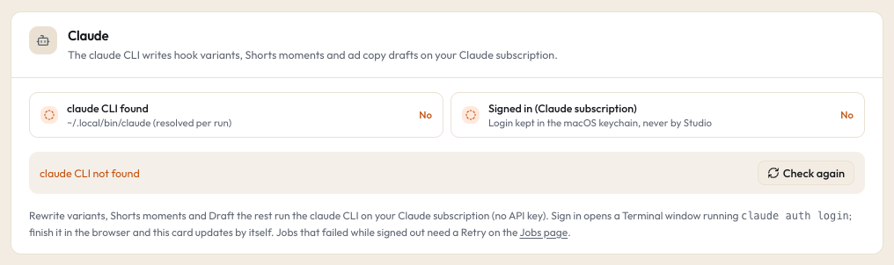

# Claude (the claude CLI)

Studio uses Anthropic's Claude Code command line tool, `claude`, to write text: new versions of a hook, Shorts moments from an episode, and ad copy drafts. It runs on **your own Claude subscription login**. Studio never uses an Anthropic API key and never calls the Anthropic API directly.

## What it powers

| Button | Where | What claude writes | Time limit |
|---|---|---|---|
| **Rewrite variants** | Hooks tab, on a hook row | 5 new versions of the hook, each with a different copy mechanic | 3 minutes |
| **New short** (moments) | Brand lane, Shorts tab | Moments from an episode transcript (Studio keeps those that run 30 to 90 seconds after snapping to sentences), each with a cold open and hook words | 15 minutes |
| **Draft the rest** | New PAUSED ad dialog | The empty headline, primary text and description slots | 3 minutes |

Studio checks everything claude returns against its own rules in code (copy rules, sentence boundaries, lengths) and drops what fails. Variants and moment hooks are then scored by [Jev](typesafe-jev.md) right away, even while hook scoring is paused (when a Jev key is set).

See [Hooks](../guide/hooks.md), [Shorts](../guide/shorts.md) and [Running](../guide/running.md).

## What it costs

No money through Studio. Each run uses your Claude subscription's usage, the same as using Claude Code yourself. A variants or ad copy run is small (a prompt of a few thousand tokens, a short JSON answer). A moments run is much bigger: it sends the whole episode transcript, sentence by sentence, so it uses more of your usage and takes longer. The jobs run one at a time per kind.

## Install and connect

1. Install Claude Code. One way, with npm:

```bash
npm install -g @anthropic-ai/claude-code
```

Anthropic's own installer works too; it puts `claude` in `~/.local/bin`.

2. Sign in with your Claude subscription. The easiest way is in Studio: **Settings > Claude**, click **Sign in**. Studio opens a Terminal window that runs `claude auth login --claudeai`; finish the sign in in your browser, and the card updates by itself. Or run it yourself:

```bash
claude auth login --claudeai
```

The login is kept by the claude CLI in your macOS keychain. Studio never sees it.

Studio looks for `claude` in this order: `CLAUDE_BIN` (a full path in your settings file `~/.studio/.env` or the process environment, which wins), `~/.local/bin/claude`, `/opt/homebrew/bin/claude`, `/usr/local/bin/claude`. It resolves links at every run, so an update of the CLI is picked up by itself.

## Check that it works



**Settings > Claude** shows:

- **claude CLI found**: Yes or No.
- **Signed in (Claude subscription)**: Yes or No, and the state line: "Signed in" (with the sign-in method in brackets when the CLI reports one, for example "Signed in (claude.ai)"), "Signed out: claude jobs fail until you sign in", "Waiting for the sign-in in Terminal…", "claude CLI not found" or "Could not tell".
- **Check again** asks the CLI again. This check runs `claude auth status`, which is free and local.

## How Studio runs it

Every run is locked down:

- Only in the worker, one job at a time per kind (variants, moments, ad copy).
- `claude -p` with **no tools** (`--tools ""`), **no MCP servers** (an empty, strict MCP config), **no settings files** (`--setting-sources ""`), `--safe-mode` (no CLAUDE.md, skills, plugins or hooks), no saved session, and Studio's own short system prompt. claude can only read the prompt and answer with JSON. It cannot open your files or run commands.
- A minimal environment: `HOME`, `USER`, `LOGNAME`, `LANG`, `TMPDIR`, `NODE_ENV` and a basic `PATH`. No `ANTHROPIC_API_KEY` or any other key can reach it.
- Never `--dangerously-skip-permissions`. A shell alias that adds it is never used, because Studio runs the binary directly.
- A temporary working folder inside Studio's cache, stdin closed, its own process group, and the time limit above. A timeout stops claude and anything it started.
- Each job's command line (with the prompt left out) and result go to a log file: `logs/jobs/hook-variants-<id>.log`, `logs/jobs/short-moments-<id>.log` or `logs/jobs/ad-copy-<id>.log`.

What goes into the prompt: the hook or the episode's sentences, your notes and copy rules for that channel, and for ad copy the angle from your approved copy doc or ad map. Nothing else from your Mac.

## Cancel and Retry

On the Jobs page (and next to the button that started it), a job can be **cancelled while it waits** ("Cancelled before it started."). A failed or cancelled job has **Retry**, which runs claude once more.

## Switch it off

- Sign out of the claude CLI, or leave it uninstalled. The three buttons then fail with a clear message, and everything else works.
- `STUDIO_ENGINES=off` in the process environment hides the claude CLI (and Higgsfield and Codex) even when installed. The demo uses it.

## Common problems

See [troubleshooting](../troubleshooting.md#claude-jobs-fail-signed-out).
