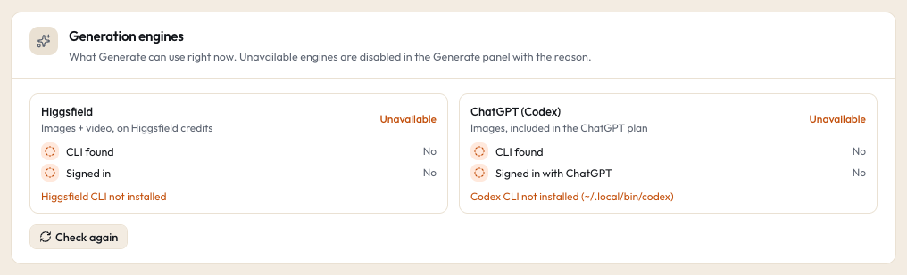

# Higgsfield (Generate images and video)

Higgsfield is a paid image and video generation service. Studio drives it through Higgsfield's own command line tool, `higgsfield`, signed in to your Higgsfield account. Every run is priced in Higgsfield credits and needs your click to confirm.

## What it powers

- The **Generate** panel's image and video models (the list comes live from the CLI and refreshes daily).
- The **quick tools** on image and video cards, the drawer and cmd+K: **Upscale**, **Remove background** and **Reframe 9:16**.
- **Remix** (run a generation again with changes) and **Run again** on a quick tool output.

See [Generate](../guide/generate.md) for how the panel works.

## What it costs

Higgsfield credits, from your Higgsfield plan. Studio never spends without asking:

1. Before every run, Studio asks Higgsfield for a **quote** (`generate cost`), which is free.
2. You see the quote (and your balance) and confirm with **one click**. No confirm, no run.
3. Studio refuses to start a Higgsfield run that has no quote.

A few quotes are a floor, not an exact price: **video Upscale** and **video Remove background** are shown as "at least" with "Estimate may be low: Higgsfield quotes this without the clip length". The video tools also show "First real run" until one run of that tool has finished on your install, because they were not tested with real credits before release.

**Credits are spent when the job starts on Higgsfield.** After that:

- **Cancel** works only while the job is still waiting in Studio's queue ("Cancelled before it started. No credits were spent."). Once it has started, it cannot be cancelled: "It already started on Higgsfield, so it can't be cancelled: the credits are spent." Higgsfield's CLI has no cancel.
- **Retry** after Higgsfield itself failed the job starts a new job and spends credits again. The Jobs page says so on the button ("Retry · spends N credits").
- **Retry** after a local problem (the download or the move into your library failed) only fetches the same finished job again, for free ("Re-polls the same Higgsfield job and downloads it again. No new credits.").
- If Studio cannot tell whether a job was created (for example the CLI timed out while uploading), the Jobs page warns you before a Retry that could spend twice.

## Install and connect

1. Install Higgsfield's command line tool by following Higgsfield's own instructions, and sign in with it using its login command.
2. Studio looks for the `higgsfield` command in these places, in order:
   - the path in the `HIGGSFIELD_BIN` environment variable,
   - `~/.local/bin/higgsfield`,
   - `/opt/homebrew/bin/higgsfield`,
   - `/usr/local/bin/higgsfield`.

   When the command is an npm wrapper, Studio runs the native binary inside the package directly, so it works under the background services too.

If your `higgsfield` lives somewhere else, set `HIGGSFIELD_BIN` to its full path in your settings file (`~/.studio/.env`). The background services read it from there too. A value in the process environment wins over the file.

3. Restart the worker (or the background services) so it finds the CLI.

## Check that it works



Open **Settings > Generation engines**. The **Higgsfield** check shows:

- **CLI found** and **Signed in**.
- Your **balance** in credits and your plan, when available.
- **Available** or **Unavailable** with the reason ("Higgsfield CLI not installed", "Higgsfield CLI is not signed in").

An unavailable engine is greyed out in the Generate panel with the same reason.

## Where results go

Every output lands on your media drive, inside one folder Studio is allowed to write to:

```text
<STUDIO_DRIVE>/Studio Generated/<lane folder>/<date>_<engine>_<model>_<prompt words>_<n>.<ext>
```

- The lane folders come from the business profile's `generated` setting (defaults: `Brand`, `Clients`, `Company`). Clients lane outputs go into a folder per client code, or `_shared`.
- Quick tool outputs are named `<date>_<engine>_<tool>_<source file name>_<n>.<ext>` and go to the source file's lane (and client, when it has exactly one).
- Next to each output Studio writes a `.gen.json` sidecar with the prompt, model, every setting, the quote and the references.
- Studio never overwrites a file; a name already taken gets `-2`, `-3`.
- Generate needs the drive (or media folder) to be available. While it is not, the Generate buttons say why.

**Discard** (drawer) moves a generated file and its sidecar to the macOS Trash. It works only on files Studio generated, inside `Studio Generated`.

## What Studio sends, and what it never does

- Runs happen only in the worker (up to 3 Higgsfield jobs at a time). The web app only reads free things from the CLI: the model list, model settings, quotes, your balance and sign-in state.
- Reference files you add are uploaded by the CLI as part of the run. Quotes never upload your files.
- The CLI is always started with an argument list, never through a shell.
- The account email the CLI reports is never shown or stored.

## Switch it off

- Leave the CLI uninstalled or signed out: Generate shows Higgsfield as unavailable and everything else works.
- `STUDIO_ENGINES=off` in the process environment hides every outside engine (Higgsfield, Codex and the claude CLI) even when installed. The demo uses this. See [configuration](../configuration.md).

## Common problems

See [troubleshooting](../troubleshooting.md#generate-says-an-engine-is-unavailable).
