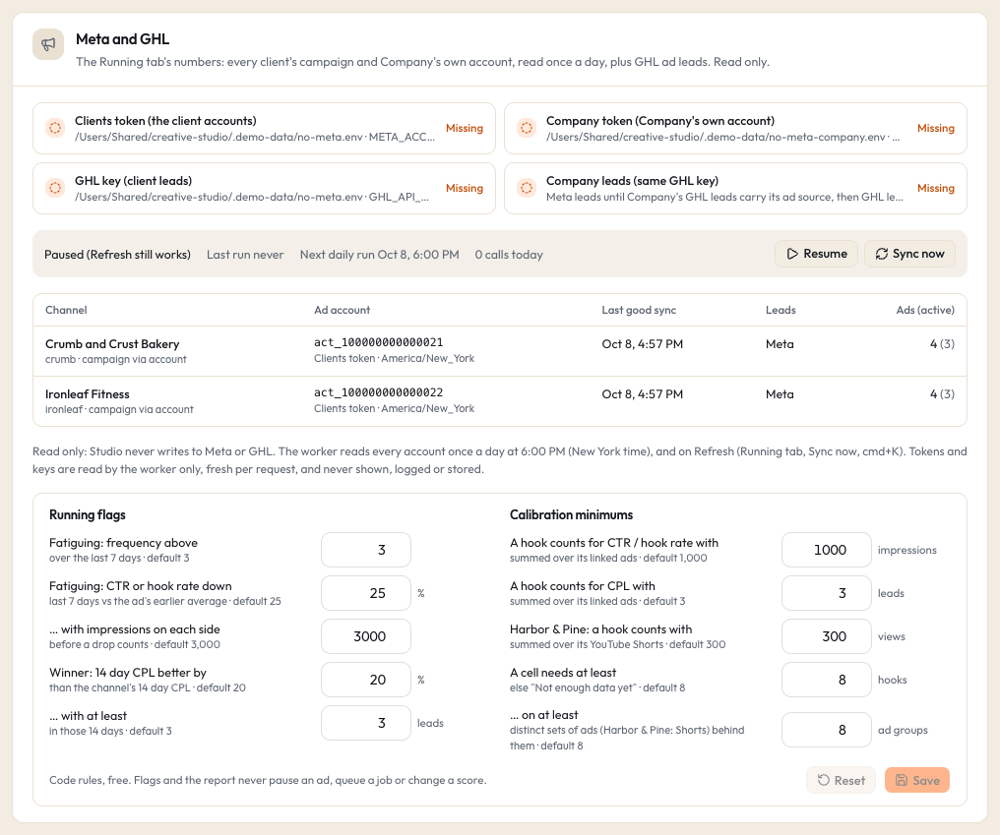

# Meta (Facebook and Instagram ads)

Studio reads your Meta ad accounts once a day and shows the numbers on the Running tab, next to the local files the ads were made from. It only reads. Studio never creates, edits, pauses or deletes anything in Meta.

## What it powers

- **Running tab** for each client in the Clients lane, for "All" clients, and for the Company lane: spend, leads, cost per lead, CTR, CPM, cost per link click, hook rate, hold rate, frequency and days running, per ad and per channel, for Today, 7 days and All time.
- **Ad to file matching**: each ad is linked to the local file it uses, so its numbers show up next to that file.
- **Hooks from ad copy**: every ad's headlines and the first sentence of each primary text become hooks on the Hooks tab ("From Meta"), with the ad's numbers on the hook row. Scoring them needs [Jev](typesafe-jev.md).
- **Flags** (fatiguing, winner), the **test order** suggestions on the Client tab, and **calibration** on the Rubric page.
- **Leads**: Meta's own lead count by default, or GoHighLevel contacts when you set that up (see [GHL](ghl.md)).

New PAUSED ads are a separate thing: Studio only writes an order file that an outside ad apply script turns into a paused ad. See [ad orders](../formats/ad-orders.md) and [Running](../guide/running.md).

## What it costs

Nothing on Studio's side. Meta does not charge for reading the Marketing API. Meta does rate limit apps, especially new apps on the basic access tier, and Studio slows down by itself when Meta says usage is high.

## Two tokens, two env files

Studio has two Meta identities, each with its own env file:

| Lane | Env file key | Default file | Holds |
|---|---|---|---|
| Clients lane (every client's ad account) | `META_ENV_FILE` | `~/.studio/meta.env` | `META_ACCESS_TOKEN`, optional `META_GRAPH_VERSION`, and the GHL key if you use it |
| Company lane (one company's own ad account) | `META_FKB_ENV_FILE` | `~/.studio/meta-company.env` | `META_ACCESS_TOKEN`, optional `META_GRAPH_VERSION` |

You only need the file for the lane you use. The key names in the first column are the settings that point at the files; change them only if you keep the files somewhere else (see [configuration](../configuration.md)).

`META_GRAPH_VERSION` pins the Graph API version, like `v21.0` (the default when the line is missing). Studio keeps using that version even when Meta's paging links point at a newer one.

## Get a token

Studio needs a token that can **read** the ad accounts you want to see. The usual choices:

- A **system user access token** from your Meta Business settings, for a system user that has been given access to each ad account, with the `ads_read` permission. This is the steadiest option: it does not expire after a few weeks.
- A **user access token** with `ads_read` from your own Meta app. These expire, so you will need to replace the token from time to time.

Studio never needs write permissions. Do not give it `ads_management` if you can avoid it.

## Connect it

1. Create the env file for the Clients lane (skip if you only use the Company lane):

```bash
touch ~/.studio/meta.env
```

```bash
chmod 600 ~/.studio/meta.env
```

```bash
open -e ~/.studio/meta.env
```

2. Add your token on its own line and save:

```text
META_ACCESS_TOKEN=paste-your-token-here
```

3. For the Company lane, do the same with `~/.studio/meta-company.env`.

4. Tell Studio which ad accounts to read:
   - **A client's account**: **Settings > Clients**, click **Edit** on the client (or **Add client**), and fill **Meta ad account** with the id, which looks like `act_` followed by digits (for example `act_100000000000021`). You can also set it in `studio.config.json` as the client's `metaAdAccount`.
   - **The Company lane's account**: only in `studio.config.json`, as `lanes.fkb.metaAdAccount`. Set it before Studio's first start (see [the limits below](#limits-to-know)).

5. Pick which campaigns and leads count for each client in the same **Edit** dialog:

| Field | Choice | What it does |
|---|---|---|
| Campaigns | **Every campaign** (`all`, the default) | Reads every campaign in the account; the channel numbers are account level |
| | **One campaign** (`one`) | Reads only the campaign id you type. Studio checks the id belongs to this ad account |
| | **From state.json** (`state_json`) | Reads `campaign_id` from `<code>/state.json` (else `<code>/build_state.json`) in the folder that holds `META_ENV_FILE`; else the first campaign whose name contains the client code (or the profile's `ads.campaignWord`, when you set one); else the only campaign. See [client files](../formats/client-files.md) |
| Leads | **Meta leads** (`meta`, the default) | Meta's own lead count. No GHL needed |
| | **GHL leads** (`ghl`) | GoHighLevel contacts with the client's source. See [GHL](ghl.md) |
| | **Meta, then GHL** (`auto`) | Meta leads until a GHL contact carries the source, then GHL leads |

The Company lane takes the same options in the config file (`lanes.fkb.campaigns`, `lanes.fkb.leads`, `lanes.fkb.ghlSource`, `lanes.fkb.ghlLocation`).

6. Click **Sync now** in **Settings > Meta and GHL**, or **Refresh** on any Running tab. The worker picks it up within about 15 seconds.

The first sync of an account reads every day since each campaign started (in 31 day chunks), so it can take a few minutes. Later syncs read the last few days and fill any days that were missed while the worker was off.

## When it syncs

- Once a day at **6:00 PM New York time** (America/New_York), for every account whose last good sync is older than that.
- Right after the worker starts, if an account missed today's run.
- Whenever you click **Refresh** (Running tab), **Sync now** (Settings), or "Refresh Meta" in the command palette (cmd+K). A Refresh runs every account, even while paused.
- An account that failed is tried again at most once an hour.

Accounts sync one at a time. A failure is recorded on that account and the next one still runs; the failed account keeps its last good numbers.

Which ads are kept: every ACTIVE ad, plus any other ad that delivered in the last 30 days, plus every ad a Studio order created (see [ad orders](../formats/ad-orders.md)), even one that has never delivered; those count as paused unless Meta says ACTIVE. Daily rows are never deleted.

## Check that it works



In **Settings > Meta and GHL**:

- The presence lines show whether each env file has a token (yes or no, never the token).
- The state line shows Idle, Syncing, Paused or Waiting (or "Worker offline" when the worker is not running), the last run, the next daily run and how many Meta calls were made today.
- The table has one line per ad account: its last good sync, where its leads come from, how many ads (and how many active), and the last error in orange if there is one.

The **Jobs** page also has a "Meta sync" row and lists accounts with errors (with **Clear**).

## What Studio reads, and what it never does

- Every Meta call is a `GET` to `graph.facebook.com`. The code that talks to Meta has no way to send anything else: other methods, other hosts and the parameters that could turn a read into a write (`method`, `_method`, `batch`) are refused before a connection opens.
- Studio reads: the account's time zone, campaigns, ads (names, statuses, creative text, video ids, image hashes, a 480 px thumbnail link), daily ad insights, reach per window, and the media names of ads it could not match to a file. Thumbnails of unmatched ads are downloaded once into Studio's cache.
- Only the worker calls Meta. The web app only stores your Refresh or Pause click and manual ad to file links.
- The token is read fresh for each request (a new token works without a restart) and sent only in the `Authorization` header. It is never put in a URL, the database, a log, an error message or the browser. Settings shows only whether it is there.
- Every request is logged in the `meta_calls` table with its path (no query string), status and time. The log keeps 30 days.
- Optional files Studio reads from the folder that holds `META_ENV_FILE` (never writes): each client's `state.json` / `build_state.json` and ad map `video_script_map.json`. See [client files](../formats/client-files.md).

## Pause it or switch it off

- **Pause**: **Settings > Meta and GHL**, click **Pause** (or "Pause Meta sync" in cmd+K). The daily run waits; Refresh still works. Click **Resume** to undo.
- **One client off**: clear its **Meta ad account** in **Settings > Clients** (only possible before it synced, see below), or **Hide** the client.
- **All off**: delete `META_ACCESS_TOKEN` from the env file. Each account then shows "No META_ACCESS_TOKEN in the META_ENV_FILE file." and keeps its last numbers.

## Limits to know

- **A client's ad account cannot change once it has synced numbers.** Settings says: "This client's ad account already has synced numbers, so it cannot change. Add the new account as a new client (with a new code)."
- One ad account can belong to only one client.
- The Company lane's account and its campaign and lead options are read from `studio.config.json` once, on the first start that sees them. There is no Settings control for them, and editing those options in the file later does not change the lane.
- Meta's "7 days" window ends yesterday (Meta's own `last_7d`), while GHL lead counts include today. When the last good sync is not from today, the Running tab says "Last synced <day>: numbers stop there".

## Common problems

See [troubleshooting](../troubleshooting.md#meta-sync-errors) for token errors (`Meta 400 (#190)` and similar), "could not identify the campaign", rate limit waits and accounts that never sync.
