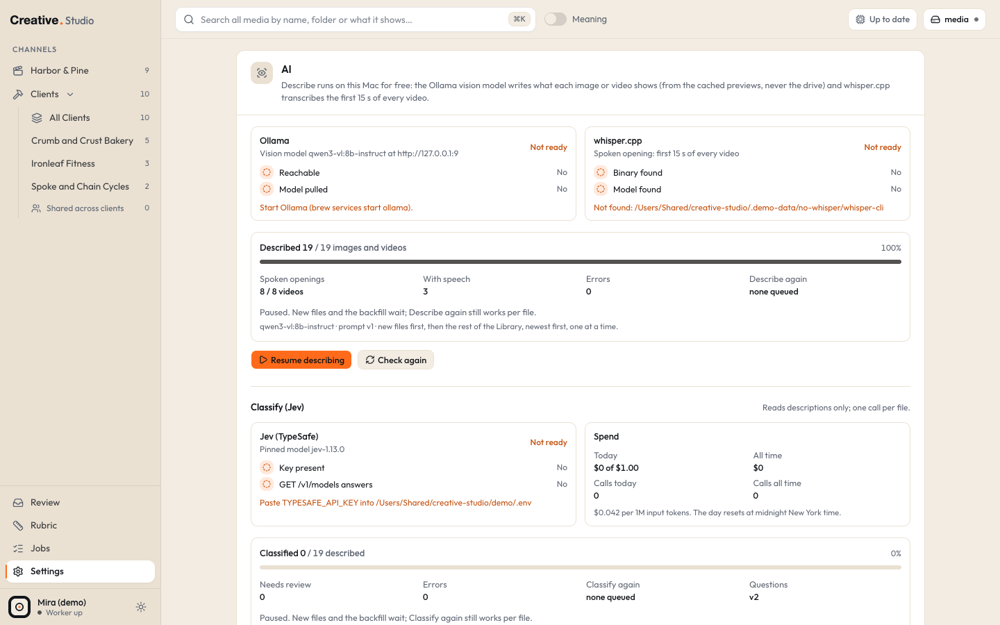

# Ollama (Describe)

Ollama runs AI models on your own Mac. Studio uses it with a vision model to write a short, plain description of what every image and video in your library shows. It is free, needs no account, and nothing leaves your Mac.

## What it powers

- **Describe**: the "AI description" in the asset drawer, written from the cached previews.
- **Plain search over descriptions**: the Library search box also matches words in descriptions.
- Everything that reads descriptions: [Jev](typesafe-jev.md) classifies from them, search by meaning ranks them, video hooks are built from them. Without descriptions, those features have nothing to work with.

Spoken openings (what is said in the first 15 seconds of a video) come from [whisper](whisper.md), not Ollama.

## What it costs

Nothing. The model runs on your Mac's GPU. It does use memory and some heat while the backfill runs.

Measured on the original install (an Apple Silicon Mac, model already loaded): about 1.7 seconds per image and about 2.1 seconds per video. The first call after the model loads is several seconds slower. A library of a few thousand files takes an hour or two the first time; after that only new or changed files are described.

## Install and connect

1. Install Ollama with Homebrew:

```bash
brew install ollama
```

2. Start it as a background service, so it is running whenever you log in:

```bash
brew services start ollama
```

3. Download the vision model Studio uses by default (a download of several gigabytes):

```bash
ollama pull qwen3-vl:8b-instruct
```

4. Check that the model is there:

```bash
ollama list
```

You should see `qwen3-vl:8b-instruct` in the list.

That is all. Studio looks for Ollama at `http://127.0.0.1:11434` and the worker starts describing within a few seconds.

### Settings you can change

| Key | Default | What it does |
|---|---|---|
| `STUDIO_VISION_MODEL` | `qwen3-vl:8b-instruct` | The Ollama model that writes descriptions |
| `STUDIO_OLLAMA_URL` | `http://127.0.0.1:11434` | Where Ollama listens. **Loopback only**: `127.0.0.1`, `localhost` or `[::1]`. Any other host is refused at startup, so your media can never be sent to another machine |

Set them in the env file or the config file's `env` section (see [configuration](../configuration.md)), then restart Studio and the worker.

Changing `STUDIO_VISION_MODEL` makes every file due again: the whole library is described again, and then classified again by Jev (which costs money). The default model was chosen and tested for this job; another vision model may describe worse.

## Check that it works



Open **Settings > AI**. The **Ollama** check shows:

- **Reachable**: Ollama answered at the configured address.
- **Model pulled**: the vision model is downloaded.
- When something is wrong, a hint below it: "Start Ollama (brew services start ollama)." or "Run: ollama pull qwen3-vl:8b-instruct".

Under the checks, the progress bar shows how many images and videos are described, and the state line says whether Describe is running, idle, paused or waiting (for example "Waiting: Ollama is not reachable at http://127.0.0.1:11434. Retrying on its own."). **Check again** re-runs the checks.

## What Studio sends, and what it never does

- Describe runs only in the worker, one file at a time.
- It reads **only Studio's own cached previews**: the thumbnail for images; for videos, frames from the start of the 480p proxy, the poster and the contact sheet. It never opens your original files, so it works while your drive is unplugged and can never change it.
- Images go only to the loopback Ollama address. No key, no account, no network beyond your own Mac.
- Results are cached by file content, so a copy of a file is never described twice.

## Pause it or switch it off

- **Pause**: Settings > AI, **Pause**. New files and the backfill wait. **Describe again** on a single file still works. Click **Resume describing** to continue.
- **Off**: stop Ollama (`brew services stop ollama`). Describe waits quietly and retries on its own (every 5 seconds, backing off to once a minute); nothing is marked as failed.
- Describe again: the drawer's **Describe again** re-runs one file, skipping the cache.

## Common problems

See [troubleshooting](../troubleshooting.md#describe-is-waiting-for-ollama).

Related: [Describe, Classify and Review](../guide/describe-classify-review.md), [install](../install.md).
