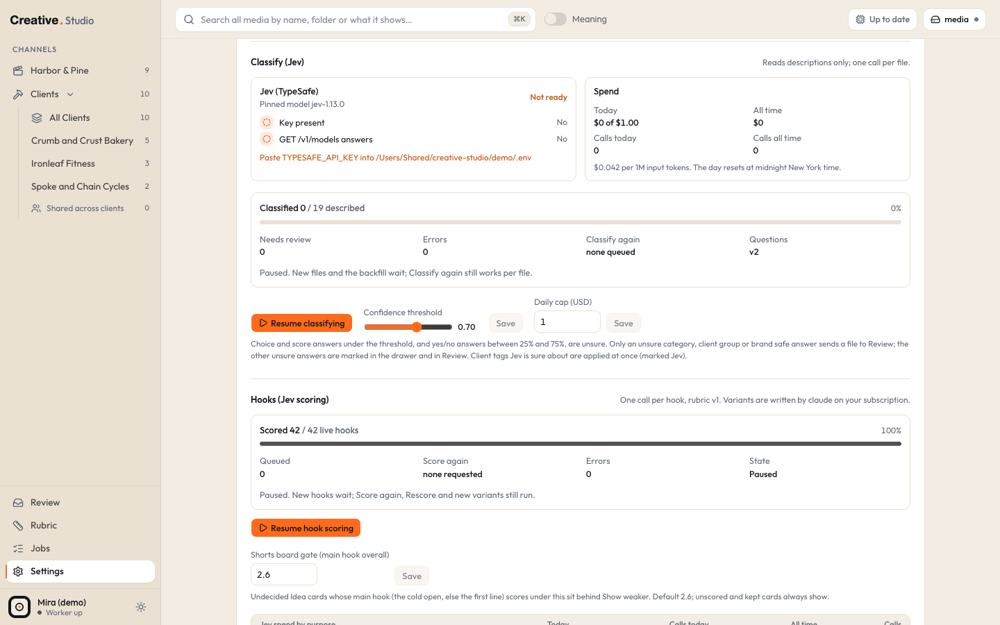

# Jev (TypeSafe)

Jev is TypeSafe's text model. Studio uses it to file your media, score your hooks and rank search results by meaning. It is the only scoring engine Studio supports, and it is the only paid service the app calls by itself (inside a daily cap you set).

Jev only ever sees text: file descriptions, spoken openings, file and folder names, hook lines and your notes. It never receives an image, a video or an audio file.

## What it powers

| Feature | Where you see it | Without a key |
|---|---|---|
| Classify (category, energy, client tags, brand safe, visual format, the three P's) | Library filters, the drawer's "Jev tags", the Review page | Files are described but never filed; Review stays empty |
| Hook scores (overall, dimensions, the three P's, avatar, style) | Hooks tab, Client tab, Rubric page, Shorts board cold opens | Hooks are listed unscored |
| Search by meaning (the Meaning switch next to the search box) | Library, Search | You get the plain text search instead |
| Calibration (scores against real Meta and YouTube results) | Rubric page | Nothing to calibrate |
| The copy gate CLI (`scripts/score-copy.ts`) | Run from Terminal or an outside ad tool | Every line comes back with `pass: null` |
| The landing page scorer CLI (`scripts/score-page.ts`) | Run from Terminal or an outside page tool | Every section comes back unscored |

Rewrite variants, Shorts moments and "Draft the rest" do not use Jev. They use the [claude CLI](claude-cli.md). Describe does not use Jev either: it runs on [Ollama](ollama.md) and [whisper](whisper.md) on your Mac.

## What it costs

Jev bills input tokens only. TypeSafe's published price, when this was written (October 2026), was $42 per billion input tokens, which is $0.042 per 1 million. Studio uses that same figure for its own bookkeeping (`JEV_PRICE_PER_M_INPUT` in `src/lib/ai/jev.ts`). Check TypeSafe's current price before you start; if it changed, Studio's spend numbers will be off by the same factor.

These numbers were measured on the original install. Your bill depends on how long your descriptions and notes are, so treat them as a rough guide:

| Call | Input tokens per call | About |
|---|---|---|
| Classify one file, no client questions | about 2,000 | $0.0001 |
| Classify one file in the Clients lane, with client questions | about 3,500 | $0.00015 |
| Score one text hook | about 2,800 to 3,900 | $0.00012 to $0.00016 |
| Score one video hook | about 3,300 to 4,400 | $0.00014 to $0.00019 |
| One search by meaning over 200 candidates | about 60,000 to 70,000 in total | $0.003 |

A search by meaning now reads up to 400 candidates (16 requests of 25), so a broad search can cost about twice the last row. Identical searches within 10 minutes are served from a cache for free, and each server process allows at most 20 paid searches per minute.

### The daily cap

Every Jev call checks a daily cap first. If today's spend, plus calls still in flight, plus an estimate for this call would pass the cap, Studio does not send the request.

- Default: $1 per day.
- Range: $0 to $20.
- The day runs on New York time (America/New_York): the cap resets at midnight there.
- Set it in **Settings > AI**, in the "Classify (Jev)" section, field **Daily cap (USD)**, then **Save**.
- Setting it to `0` stops every Jev call. That is the quickest way to switch Jev off without deleting the key.

When the cap is reached, Classify and hook scoring wait until midnight New York time ("Daily Jev cap reached. Classify resumes after midnight."), and search by meaning falls back to the plain search ("Daily Jev cap reached. Plain search still works.").

The cap is checked per process, so two processes calling Jev at the same moment (the worker classifying while you search) can pass it by a few cents at most.

## Connect it

### Get a key

TypeSafe calls Jev "early access". Keys are made in TypeSafe's API console at [console.typesafe.ai](https://console.typesafe.ai/):

1. Sign in to the console, with Google or with a code TypeSafe sends to your email.
2. Open **API Keys** and create a key. Copy it right away and keep it somewhere safe.

When this was written (October 2026), TypeSafe had paused new sign ups (since September 22, 2026); accounts made before that still work. Check the console to see whether sign ups are open again. Without a key, everything in Studio that does not need Jev keeps working: the Library, Describe, search by name and description, adding and editing hooks (unscored), the Running tab and Generate. See [what it powers](#what-it-powers) for what waits for a key.

### Put the key in Studio

1. Open Studio's env file in a text editor. On a fresh install it is `~/.studio/.env` (Studio creates it from a template on first start; **Settings > Paths** shows the exact file on the "Config" row).

```bash
open -e ~/.studio/.env
```

2. Paste the key after `TYPESAFE_API_KEY=` on its own line, with no quotes and no spaces:

```text
TYPESAFE_API_KEY=paste-your-key-here
```

3. Save the file. You do not need to restart: Studio reads the key fresh on every call.

The key must be in the env file. Setting `TYPESAFE_API_KEY` in your shell does nothing, and the key does not belong in `studio.config.json` either.

### The pinned model

`STUDIO_JEV_MODEL` sets which Jev model answers. The default is `jev-1.13.0`. It must be a versioned id like `jev-1.13.0`; the moving aliases `jev-latest` and `jev-preview` are refused at startup, because a model that changes under you would make old and new scores impossible to compare (calibration depends on that). TypeSafe's public pages do not say whether a key made today can call `jev-1.13.0`. If your key cannot, classify and hook scoring calls fail with a request error on the Jobs page; then set `STUDIO_JEV_MODEL` to a versioned id your console offers.

Change it only on purpose. A different model makes every classified file due again, so the whole library is classified again (and paid for again). See [configuration](../configuration.md) for how to set it.

## Check that it works



1. Open **Settings > AI**. In the "Classify (Jev)" section, the **Jev (TypeSafe)** check shows two rows:
   - **Key present**: Yes when the env file has a key.
   - **GET /v1/models answers**: Yes when TypeSafe answered a free model list request with your key. This check spends nothing.
2. The **API keys** card on the same page shows "Jev (TYPESAFE_API_KEY)" with a yes or no. It only ever shows whether the key is there, never the key.
3. After the first real calls, the **Spend** facts (Today, All time, Calls today, Calls all time) and the **Jev spend by purpose** table fill in. Purposes are Classify, Search by meaning, Hook scoring, Copy gate, Page scoring and Tests.

## Start the queues (they begin paused)

On a fresh install, Classify and hook scoring start **paused**, so nothing is spent until you look at a small sample first. Describe is not paused (it is free and local).

- To start Classify: **Settings > AI**, "Classify (Jev)" section, click **Resume classifying**.
- To start hook scoring: **Settings > AI**, "Hooks (Jev scoring)" section, click **Resume hook scoring**.

While paused, single requests still run: **Classify again** on one file, **Score again** on hooks, a Rescore you approve on the Rubric page, and new hook variants. A good first run is to Classify again a handful of files, check them in Review, then resume.

## What Studio sends, and what it never does

- Studio talks to one host for Jev: `https://api.typesafe.ai/v1`.
- Classify, hook scoring and the queues run only in the worker. Search by meaning is the one paid call the web server makes, and only for the app's own page (another site cannot trigger it). The two CLIs make calls only when you run them.
- Each request carries a small JSON "state" (descriptions, spoken openings, file names, folder labels, your notes and the "who's who" note) and the questions. No media files.
- Every call that reaches TypeSafe is logged in the `ai_calls` table: purpose, answering model, the questions, the size of the state (never the state itself), input tokens, the answers, cost and time. The key is never logged.
- The key is read from the env file only by the Jev adapter, fresh for each request, and sent only in the `Authorization` header. It never goes into the database, a log line, an error message or the browser.
- Rate limits (429), overload (529), server errors and network errors are retried with backoff (up to 4 attempts, 60 seconds each). A refused key (401, and a 403 is handled the same way) and a refused request (422) are never retried.

## Pause it or switch it off

- Pause Classify or hook scoring in **Settings > AI** (**Pause classify**, **Pause hook scoring**). Paused queues keep everything they already did.
- Set **Daily cap (USD)** to `0` to stop every Jev call, including search by meaning and the CLIs.
- Remove the line `TYPESAFE_API_KEY=...` from the env file to disconnect completely. Everything that does not need Jev keeps working.

## Common problems

See [troubleshooting](../troubleshooting.md#jev-no-key-key-refused-or-cap-reached) for "No Jev key", "Jev refused the key", "Daily Jev cap reached" and "Jev is not answering".

Related pages: [Describe, Classify and Review](../guide/describe-classify-review.md), [Hooks](../guide/hooks.md), [copy gate CLI](../formats/copy-gate-cli.md), [page scorer CLI](../formats/page-scorer-cli.md).
