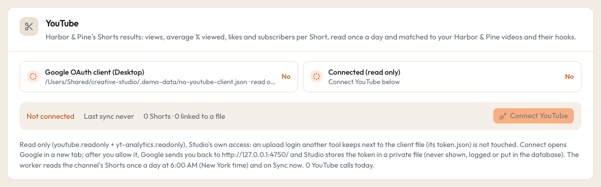

# YouTube (Shorts results)

Studio can read your own YouTube channel's Shorts once a day and show how each one did next to the Brand lane video it was cut from. It uses its own read-only access: it cannot upload, edit or delete anything on YouTube.

## What it powers

- The **YouTube Shorts** list on the Brand lane's Shorts tab (`/rtm/shorts`): every Short with its views, average % viewed, likes and subscribers gained, matched to a local file.
- Short numbers on the Brand lane's hook rows (the matched file's video hook).
- On the Shorts board: a card moves to **Posted** by itself when its reel file is matched to a Short, and posted cards show "% viewed" against your channel's median.
- Brand lane **calibration** on the Rubric page (hook scores against views and % viewed).
- The reel kit comparison: kit versions and kit test winners, by % viewed. See [kit notes](../formats/kit-notes.md).

## What it costs

Nothing. The YouTube Data API and YouTube Analytics API are free within Google's daily quota, and one daily sync of a channel uses a small part of it.

## What counts as a Short

YouTube's API has no "this is a Short" flag. Studio counts an upload as a Short when it is **180 seconds or shorter**. Every upload is stored; only those count as Shorts.

## Set up a Google OAuth client (one time)

Studio signs in with **your own** Google Cloud OAuth client, so you need a small Google Cloud project. In the Google Cloud console:

1. Create a project (any name).
2. Under **APIs and services > Library**, enable **YouTube Data API v3** and **YouTube Analytics API**.
3. Under **OAuth consent screen**, set it up for an **External** app and add your own Google account as a **test user**.
4. Under **Credentials**, choose **Create credentials > OAuth client ID**, application type **Desktop app**.
5. Download the client's JSON file.
6. Save it where Studio looks for it, `YOUTUBE_CLIENT_SECRET_FILE`. On a fresh install that is `~/.studio/youtube-client-secret.json`. For example, if the download landed in your Downloads folder as `client_secret.json`:

```bash
mv ~/Downloads/client_secret.json ~/.studio/youtube-client-secret.json
```

```bash
chmod 600 ~/.studio/youtube-client-secret.json
```

The file must be a **Desktop** client (its JSON starts with `"installed"`). A "Web application" client is not accepted.

Google's own rule: while your consent screen is in **Testing**, the sign-in it grants can expire after about a week. If Studio keeps asking you to reconnect, publish the consent screen (you can stay the only user).

## Connect it



1. Open **Settings > YouTube**. The line **Google OAuth client (Desktop)** must say **Yes**. If it says No, the file is missing or is not a Desktop client.
2. Click **Connect YouTube**. Google's consent page opens in a new tab.
3. Pick the Google account that owns (or manages) your channel and allow **both** read-only permissions (YouTube and YouTube Analytics).
4. Google sends you back to Studio at `http://127.0.0.1:<STUDIO_PORT>/` (with the default port, `http://127.0.0.1:4747/`). The card then says "YouTube connected. The first Shorts sync starts within 15 seconds."

The sign-in link is single use and expires after 10 minutes. If you see "That sign-in link expired or was already used", click **Connect YouTube** again.

If Google grants only one of the two permissions, Studio revokes the grant and stores nothing ("Google did not grant both read-only permissions"). Connect again and allow both.

## When it syncs

- Once a day at **6:00 AM New York time** (America/New_York). Analytics numbers run through yesterday, so the morning is enough.
- Right after the worker starts, if today's run was missed.
- Whenever you click **Sync now** (Settings > YouTube) or "Sync YouTube" in the command palette (cmd+K). Sync now runs even while paused.
- A failed sync is tried again at most once an hour.

Each sync reads the channel, every upload in its uploads playlist (title, publish time, duration, privacy, thumbnail link), then lifetime numbers per Short: views, average % viewed, average view duration, likes and subscribers gained, plus engaged views, shares and comments when YouTube allows them. The numbers are stored as one snapshot per day, so growth over time is kept. Thumbnails are downloaded once into Studio's cache for Shorts with no matched file.

Shorts are matched to Brand lane video files by title and duration. If a match is wrong or missing, use **Link a file** on the Shorts list.

## Check that it works

In **Settings > YouTube**:

- **Connected (read only)** says Yes, with "private file" when the token file has safe permissions.
- The state line shows Idle, Syncing, Paused, or Reconnect needed, plus your channel title, the last sync, how many Shorts and how many are linked to a file, and the next daily run.
- "Last sync failed: ..." appears under it when the last sync failed.
- If YouTube refused some optional numbers, the card lists them ("YouTube Analytics refused: ... (left empty)").

The **Jobs** page also has a YouTube sync row.

## What Studio reads, and what it never does

- Exactly two scopes: `youtube.readonly` and `yt-analytics.readonly`. Nothing that can upload or change your channel.
- The token is **Studio's own**. It is written to `YOUTUBE_TOKEN_FILE` (default `~/.studio/youtube-token.json`) with owner-only permissions (0600, in a 0700 folder). Studio refuses a token path named `token.json` next to the client file, so it never reads or overwrites another tool's upload login kept there.
- The client file is only read, never changed.
- Token values, the client secret and the sign-in code never go into the database, a log, an error message or the browser. Google's error text is not echoed; errors are stored as a short code like `YouTube 403 (accessNotConfigured)`.
- Only the worker reads YouTube (`GET` requests to the Data and Analytics APIs, thumbnails from `i.ytimg.com`). The web app makes just two Google calls: exchanging the sign-in code when you come back from Google, and revoking the token when you click Disconnect.
- Studio never completes a Google sign-in for you. You click Connect and finish it yourself.

## Pause it or switch it off

- **Pause**: Settings > YouTube, **Pause**. The daily sync waits; Sync now still works. **Resume** undoes it.
- **Disconnect**: Settings > YouTube, **Disconnect**. Studio revokes its token at Google (best effort) and deletes the token file. The numbers already synced stay.

## Common problems

See [troubleshooting](../troubleshooting.md#youtube-says-reconnect-needed).

Related: [Shorts](../guide/shorts.md), [Settings](../guide/settings.md).
